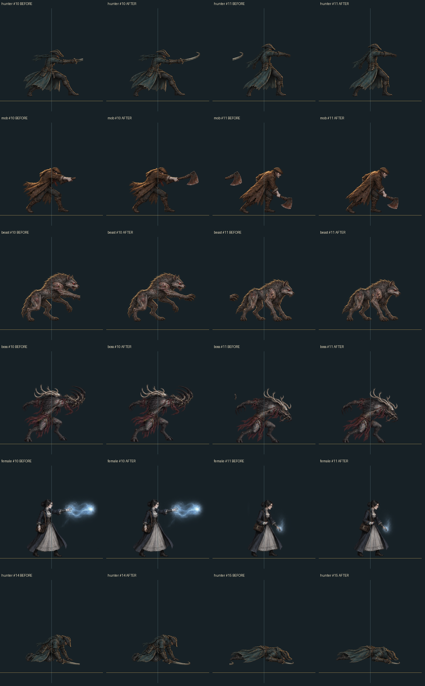

# 0.8.13-dev.5 · 전체 프레임과 동작 표시 점검

장송의 칼날로 서 있을 때 몸이 좌우로 순간이동하는 것처럼 보인다는 보고를 시작으로, 현재 사용하는 장치무기30형태와 공통 캐릭터5종의 원본 프레임800개를 점검했습니다. 이 기록은 원본 이미지·좌표 검사, 자동 검사, 실제 브라우저 재생을 구분합니다. 정식 릴리스·태그·PR 병합 기록이 아닙니다.

## 완료한 검사

| 검사 | 범위와 결과 | 근거 |
|---|---|---|
| 원본 프레임 전수 점검 | 장치무기30형태×24프레임=720, 공통 캐릭터5종×16프레임=80. 원본 PNG·atlas·등록 좌표·접촉시트에서 총800프레임 확인 | [무기 분석](analysis/weapon-audit-result.json), [일반 캐릭터 분석](analysis/generic-final-summary.json) |
| 대상 자동 검사 | 최종 접지 보정까지 포함한 프레임 소유권·대기 정렬·renderer·표시 UI 관련120개 통과, 실패0 | [원시 TAP](targeted-after-origin.tap). 아래 전체CI와 별도 실행이므로 합산하지 않음 |
| 전체CI | 접지 보정 후 최종2,597개 통과, 실패0, 589.617초 | [실행 메타데이터](ci.json), [원시 TAP](ci.tap). 접지 보정 전2,596개/529.006초의 [이전 실행](ci-before-ground.json)은 별도 보존 |
| 실제 브라우저의 최종 재생 | 최종 `?v=0.8.13-dev.5` 참조를 불러온 동작 미리보기에서30무기 형태와5공통 캐릭터 재검증 완료. 대기·양방향 걷기·공격·피격·쓰러짐·복귀, 무기 변형을 수행했고 콘솔 경고·오류0 | [입력과 공개 상태](browser/actions.json), [결과 JSON](results.json) |
| 실제 브라우저의 캐시 오류 재현 | 새 목록에서 공통 인간형 적을 골라도 장송의 칼날 상태가 유지됨. 버전 쿼리 적용 후 동일 선택이 공통 인간형 적 상태·공통 공격·변형 비활성화로 반영됨 | BB-015, [이전 캐시 기록](browser/pre-cache-reload/) |

CI 정책에서 로컬 원본 사진을 요구하는4개 검사명은 제외했습니다. 이들은 통과 수에 포함하지 않으며, 정확한 제외 목록은 실행 JSON의 `sourcePhotoTestsExcluded`에서 확인할 수 있습니다.

무기 기록의 객체 참조를 복구하기 위한 장송의 칼날 한 번의 추가 반복은 고유 검증 수에 더하지 않습니다. 30형태·5종의 첫 전체 실행 끝에서 공개 renderer 계수는 공격159/이동70/사격1, 표시 준비완료와 동작 full이었습니다. 뒤이어 야수 접지 원점 한 필드를 수정했고, 변하지 않은30무기 형태의 기록은 유지하면서 공통5종만 새 내용 해시 주소로 재검증했습니다. 이 별도 실행의 계수15공격/10이동은 앞의 횟수에 합산하지 않습니다.

## 확인한 오류와 보정

- **BB-012 · 대기 위치 등록:** 장송의 칼날 첫 형태의 대기0→1에서 부츠 중심이 정상 표시 크기 기준11.1020px, 상체가11.3547px 이동했습니다. 대기0의 등록 위치를 보정해 부츠0.0822px·상체0.1705px로 줄였습니다. 같은 오류가 확인된15형태의 대기0만 수정했습니다. 전체30형태의 수정 후 최대 잔차는 부츠1.5763px·상체1.8903px·모자1.8271px입니다. [무기 보정 목록](analysis/applied-weapon-idle-corrections.json)
- **BB-013 · 프레임 잘림과 혼입:** 인간형 적의 도끼 끝이 공격10에서 잘리고 공격11 왼쪽에 나타나는 사례 등 총12프레임을 수정했습니다. 공통 사냥꾼의 죽음14→15도 같은 오류였습니다. 주요 픽셀6,095개를 복원하고 주요 영역의 누락·혼입을0으로 확인했습니다. 고유 반투명 외곽66,502개와 기존 몸 위치를 보존했습니다. [수정 전후 계측](analysis/generic-ownership-fix-results.json)
- **BB-014 · 마스크 실패 대체 표시:** 필수 마스크를 만들지 못해 캐릭터0개가 등록된 환경에서도 준비 완료를 알리는 회귀를 독립 검토에서 재현했습니다. 모든 필수 캐릭터가 등록된 경우에만 준비 완료를 알리도록 수정했습니다. 마스크 API 미지원·생성 예외는 모의 환경 검사이며 정상 브라우저 재생과 구분합니다.
- **BB-015 · 캐시 혼합:** 새 HTML의 선택 목록과 이전 캐시 JavaScript가 함께 실행되는 오류를 실제 브라우저에서 재현했습니다. 이번에 변경한 스크립트 참조를 개발 버전 쿼리로 구분해 선택 반영을 복구했습니다. 캐시 변경 전의 재생 기록은 최종 재검증 기록에 합산하지 않습니다.
- **BB-016 · 야수 접지 원점:** 실제 발끝432보다 아래에 있던 원점460 때문에 정상 크기7px 떠 보였습니다. 원점을432/512로 맞추고16포즈의 상대 높이·기존 crop/clip·원본을 보존했습니다. 실제 사진에서도 약15px 내려온 발이 그림자에 닿으며 새 클립 파손이 없습니다. [실제 PNG 계측](analysis/beast-ground-after.json), [브라우저 비교](analysis/generic-beast-ground-fix-browser-review.json)

자세한 재현 예시·수정 전후·Issue 연결은 [오류 목록](../../bugs.md)에 보존했습니다. 관리 항목은 [Issue #19](https://github.com/dfrpg98-jpg/bloodborne-solo/issues/19), [#20](https://github.com/dfrpg98-jpg/bloodborne-solo/issues/20), [#21](https://github.com/dfrpg98-jpg/bloodborne-solo/issues/21), [#22](https://github.com/dfrpg98-jpg/bloodborne-solo/issues/22), [#23](https://github.com/dfrpg98-jpg/bloodborne-solo/issues/23)와 [PR #15](https://github.com/dfrpg98-jpg/bloodborne-solo/pull/15)입니다.

걷기는4프레임·10fps의 한 주기를 끝내도록340ms에서400ms로 조정했고, 이어지는 공격·피격 연출도 같은 이동 종료 경계를 사용합니다. 무기의 회전·돌진·들린 발, 피격 반동, 죽음의 무게 이동은 포즈의 의도한 변화로 보존합니다. 게임 비용·임무 조건·판정·저장 형식은 변경하지 않습니다.

## 증거와 범위

현재 manifest가 사용하는 **원본 PNG35개는 모두 동일 SHA-256을 유지**합니다. 보정은 atlas의 등록 위치·crop·native clip 좌표로 처리했습니다. 공통 캐릭터는 여러 실제 적·NPC가 공유하는 유형 외형이며, 개별 종마다 고유 외형·공격 모션을 완성했다는 뜻은 아닙니다.

[수정 후 전체 무기 대기 비교](analysis/all-weapons-idle-after.png)는 원본 픽셀과 메타데이터로 만든 분석 그림입니다. 실제 브라우저 화면은 `browser/`에 별도로 보존합니다. `browser/pre-cache-reload/`는 최종 버전 참조 적용 전의 캐시 혼합 기록입니다.

장송의 칼날은 실제 JPEG8장씩의 시간차 관찰에서도 발 중심의 peak-to-peak가23.25px→0.50px로 줄었습니다. 이는2.1배 미리보기의 사진 픽셀 계측이며 원본 alpha의 정확한 소수점 좌표 검사와 구분합니다. [측정법과 각 사진 해시](analysis/burial-browser-sequence-analysis.json), [시간차 비교 그림](analysis/burial-browser-before-after-sequence-analysis.png). `browser/before-ground-fix/`는 야수 원점 보정 직전의 공통5종 기록이며 최종 상태는 [접지 보정 후 재검증](browser/origin-revalidation.json)에 있습니다.

정적인 스크린샷은 촬영한 순간의 포즈만 증명합니다. 접촉시트에서800개 원본 프레임을 확인한 것과 실제 브라우저에서 동작 버튼을 재생한 것은 서로 다른 검사입니다. 모든800프레임을 실제 브라우저에서 각각 촬영했다거나, 정적인 캡처만으로 모든 전환의 움직임이 자연스럽다고 확정하지 않습니다. 최종 브라우저 결과는 기록한 동작·형태·뷰포트와 시간차 관찰 범위에 한정합니다.

[실행 파일 대조](live-files.json)는 로컬8786 서버가 제공하는 변경 파일32개를 소스와 비교한 기록입니다. [기존 사냥 적용](browser/regular-game-apply.json)에서는 새 스크립트 주소로 새로고침한 뒤 체력·위치·손패·라운드·단계 등 공개9필드가 모두 동일하고 캐릭터 ready/full, 장송의 칼날 준비완료, 콘솔 경고·오류0을 확인했습니다. 검증용 게임 상태를 바꾸지 않는 동작 미리보기를 사용하며, 사용자 일반 사냥 진행을 새 사냥으로 덮어쓰지 않습니다. Unity Editor의 전체 게임 실행, 정규 장비로 캠페인 완주, 모든 화면 크기와 기기의 시각 품질은 이번 프레임 점검 범위에 포함하지 않습니다.
