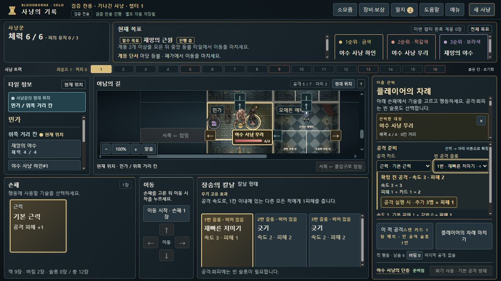

# 공격 위치·회피 제한 미리보기 · 0.8.13-dev.21

공격 전 공개 정보와 현재 선택만으로 끌어오기 도착 지형, 범위 추가 피해 인원, 회피 제한을 짧게 표시합니다. 판정·명령·저장 형식은 바꾸지 않았습니다. 선택한 적 하나만 지도 이름·체력을 표시하는 dev.19 원칙과 dev.20 마비 안개 판정·안내를 유지합니다.

| 확인한 문제와 재현 예시 | 수정한 표시 |
| --- | --- |
| BB-064: 예배당 밖의 적을 낫으로 끌어오도록 체크해도 현재 위치 공격 수치만 보여 도착 지형을 예측하기 어려움 | 선택한 적 패널 상단에 `끌어온 뒤: 오에돈 예배당 · 적 공격 속도 -1`. 다른 끌어오기 대상은 해당 체크 항목 아래에 표시 |
| BB-065: 장송의 칼날 범위 공격이 주 대상 외 세 적에게 피해를 주지만 확정 전 인원을 알기 어려움 | 확정 버튼 위에 `공격 실행 시 · 추가 3명 × 피해 1`. 말뚝박이 폭파의 범위 피해2도 실제 슬롯에서 계산 |
| BB-066: 말뚝박이 밀기에서 멈춤과 이동 경로를 `선택할 대상 2개`로 표시해 적 두 명처럼 읽힘 | `이동 선택지 2개 · 남은 이동 최대 2칸`. 이동 후 잔여 칸 수 갱신. 실제 적 대상 선택의 기존 표현은 유지 |
| BB-067: 돌망치의 파괴적인 내려찍기는 회피 불가인데 공통 안내는 회피 카드·슬롯 선택을 권함. 말뚝박이 마지막 빈 슬롯 사용의 위험도 확정 전에 드러나지 않음 | 돌망치 확정 전 `이번 전투 · 회피 불가 · 방해 면역`, 전투 중에는 회피 불가 안내. 빈 슬롯이 모두 차는 일반 공격은 슬롯 부족만 경고하며 자동 회피까지 금지한다고 단정하지 않음 |

미공개 행동 덱은 읽지 않습니다. 도착 지형은 기존 `enemyTileSpeedPenalty`, 추가 피해 범위는 실제 공격의 `splash`와 기존 거리를 사용합니다. 도약 공격은 합법 착지 위치를 기준으로 하고, 반격은 지도에서 살펴보는 다른 적 대신 실제 전투 상대를 제외합니다. 범위 표시는 **공격이 실행되는 경우의 현재 위치와 기본 피해**이며, 이후 이동·방해·사망·임무 면역으로 인한 최종 HP 감소를 확정하지 않습니다.

## 로컬 검증

[관련 14개 파일의 최종 회귀 146/146 통과](focused-tests.json), [전체 출력](focused-tests.tap), [재실행 스크립트](run-focused.cjs). 신규 검사는23개이며 기존 결과에 더해 별도 총합으로 소개하지 않습니다. 전체 CI 실행 수치가 아닙니다. 관련 제품·검사24개 파일은 실행 전후 해시가 동일했습니다.

- [위치 미리보기12개](../../../tests/attack-position-preview-v0821.test.cjs): 도착 지형·임무10/31의 과거 및 현재 정책·도약·반격·실제 범위 피해·숨은 덱 접근 금지.
- [공개 명령 QA와 실제 UI 처리기2개](../../../tests/burial-position-ui-v0821.test.cjs): 대상·카드·슬롯 변경에 따른 표시 갱신, 선택 HUD, 선택 저장 보존, 실제 공격·피해 처리.
- [말뚝박이6개](../../../tests/stake-push-preview-ui-v0821.test.cjs), [돌망치3개](../../../tests/kirkhammer-restriction-ui-v0821.test.cjs): 실제 밀기·일반 대상 선택·빈 슬롯/카드 비우기/룬 대체·회피 금지/허용의 후속 처리.

단위 검사의 전투 배치는 공급 검증을 통과한 구성 상태입니다. 브라우저 입력은 [공개 명령으로 만든 검증 모드 체크포인트 생성기](../../../tests/helpers/attack-position-qa.cjs)로 별도 생성했고, 엄격한 저장 재생도 확인했습니다. 새 일반 캠페인 완주로 보고하지 않습니다.

## 실제 브라우저

별도 `127.0.0.1:8821`에서 정상 파일 선택기·체크박스·카드/슬롯 선택·공격·전투 처리·저장 내보내기로 확인했습니다. [관찰·저장 대조](native-ui-observations.json), [대조 스크립트](verify-native.cjs)에 수치와 범위를 기록했습니다. 원래8786과 개인 저장에는 접근하지 않았습니다.

끌어오기·범위 선택 후 내보내기는 **기존 불러오기 마이그레이션을 적용한 기준 저장과** 바이트가 같습니다. 검증 입력에는 해당 정책이 없어 기존 `APPLY_TILE_SPEED_RULING`이 불러올 때 한 번 추가됐습니다. 원시 입력 파일과 선택 결과가 그대로 같다고 보고하지 않습니다. 실제 끌어오기 공격 결과16,695바이트와 범위 공격 처리 결과16,054바이트는 명시한 공개 명령의 예상 결과와 각각 전체 바이트가 같습니다.

[끌어오기 예고](evidence/pull-preview.jpg) · [실제 도착 속도](evidence/pull-committed.jpg) · [말뚝박이 슬롯 위험](evidence/stake-warning.jpg) · [밀기 선택지](evidence/stake-push-choices.jpg) · [1칸 남음](evidence/stake-push-remaining-one.jpg) · [돌망치 확정 전 제한](evidence/hammer-before-restriction.jpg) · [전투 중 제한](evidence/hammer-after-restriction.jpg).

확정 전 돌망치 첫 캡처가 선택 이전 프레임이었던 것을 읽기 검수에서 발견했습니다. 최종 이미지는 지정 슬롯 선택·제한 경고가 보이는 화면을 다시 관찰한 뒤 저장했습니다. DOM 결과만으로 이미지까지 맞았다고 간주하지 않습니다.

## 부모 보고와 남은 증거

[부모 QA 보고 접수](parent-reports.md)는 부모의 dev.20 일반 플레이 관찰이며, 원본 파일을 로컬에서 열람한 결과와 구분합니다. 끌어오기 직후 저장·일반 플레이 스크린샷, `dev20-stake-driver-push-choice-count.jpg`, `dev20-normal-stake-driver-after-push-save.json`은 아직 전달되지 않았습니다. 이번 수정 검증은 위 별도 QA 입력으로 수행했습니다.

방해 면역은 공개된 무기 효과·플래그를 확인했지만, 실제 방해 효과를 받는 별도 판정 분기를 이번에 검증했다고 확장하지 않습니다. [Issue #67](https://github.com/dfrpg98-jpg/bloodborne-solo/issues/67), BB-064–067로 관리합니다. 병합·배포하지 않은 검토 브랜치 `fix/attack-position-preview-dev21`입니다.
