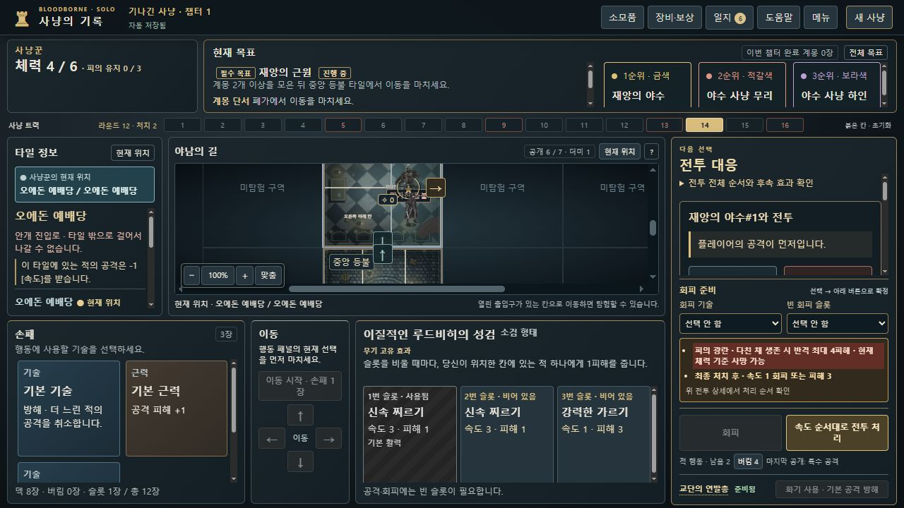

# 피의 광란의 선행 부상 반격 경고 · 0.8.13-dev.23

BB-069 / [Issue #71](https://github.com/dfrpg98-jpg/bloodborne-solo/issues/71). 체력4 야수에게 속도3·피해1을 먼저 준 뒤, 공개 때 속도2·피해2였던 피의 광란이4피해로 반격하여 체력4 사냥꾼이 사망했습니다. 기존 예고에도 조건부2~4 계산은 있었지만 접힌 순서 설명 안에만 있었고, 처리 버튼 옆 경고에는 없었습니다. 판정 오류를 고치는 작업이 아닙니다.

## 근거와 현재 기대 결과

사용자 제공 임무10 원문 전사에는 재앙의 야수가 피해를 받은 상태라면 피의 광란이 +2피해를 준다고 적혀 있습니다. [전사 원문](../../../campaigns/long-hunt/data.json:540), [공개 시 현재 체력에 따른 피해2/4](../../../mission-engine.js:271), [적 공격 속도 그룹 직전 재평가](../../../hunt-engine.js:2117)를 대조했습니다. 새 공식 FAQ 판정을 확보했다는 의미가 아닙니다.

이 저장은 기존에 채택한 `all-attacks` 판정에 따라 예배당에서 속도3→2를 적용합니다. [현재 속도 판정](../../../hunt-engine.js:798)은 변경하지 않았습니다. 원문의 예배당 면역 문구나 역사 저장의 속도 정책을 이번 UI 수정으로 다시 판정하지 않습니다.

| 공개된 순서·조건 | 현재 엔진 결과 |
| --- | --- |
| 완전체력4에 빠른 비치명 피해1 → 적이 체력3으로 생존 | 더 느린 피의 광란은 부상 조건으로4피해. 사냥꾼HP4·방어/치유 없음이면 사망 |
| 같은 속도에서 완전체력 적에게 피해 | 두 공격 처리 전 조건을 확정하므로 해당 반격은2피해 |
| 선행 치명 피해 → 부활 토큰으로 완전 회복 | 이후 반격 때 기본2피해로 돌아갈 수 있음. 아래 강화+1 대조는 실제3피해 |
| 회피 또는 선행 방해 | 반격을 막음. 이 새 증가 경고를 표시하지 않음 |
| 빠른 리게인 피해2·치유2, 사냥꾼HP4 | 선행 치유로HP6 → 반격4 → HP2 생존 |

## 수정 범위와 한계

`hunt-outcome-preview.js`의 경고와 간략 표시 우선순위만 수정했습니다. 현재 공개된 피신처 특수 공격, 같은 칸, 미처리 빠른 플레이어 공격, 완전체력 적, 공개 방어를 차감한 양수 비치명 피해, 아직 회피·취소·방해하지 않은 반격에 한정합니다.

처리 버튼 옆에 **‘피의 광란 · 다친 채 생존 시 반격 최대4피해’**를 표시하고, 선행 치유가 없으며 현재HP가 그 피해 이하이면 사망 가능성을 강조합니다. 숫자는 기존 공개 강화·발광·방어를 적용한 받을 피해이며4로 고정하지 않았습니다. 공격 비교의 공개 순간 수치2는 바꾸지 않습니다. 조건부 위험과 실제 확정 피해를 구분합니다.

선행 `afterAttackHeal`/`healDealt`가 있으면 사망 강조를 보수적으로 제외하고 최대 피해 경고는 유지합니다. 치유 후 정확한HP를 예측하는 기능은 아닙니다. 최종 처치·토큰 완치·이미 부상인 적·다른 조건부 적 능력의 전체 결과를 새로 시뮬레이션하지 않습니다. 선행 치명 피해에는 이 새 증가 경고를 추가하지 않으며 기존 부활·처치 반응 예고를 유지합니다. 미공개 행동 덱을 읽거나 명령을 가상 실행해 숫자를 맞추지 않습니다.

## 정상 원본과 QA-HISTORICAL 직접 재생

부모가 cloud8773의 dev.22 정상 공개UI에서 얻은 [134명령 사망 원본](inputs/dev22-normal-frenzy-preview-death-save.json)과, 같은 실제 획득 이력의 정확한 [공격 전132명령](inputs/QA-HISTORICAL-dev22-frenzy-before-attack-prefix132-save.json)·[처리 전133명령](inputs/QA-HISTORICAL-dev22-frenzy-declared-before-resolve-prefix133-save.json) 재구성 자료를 제공했습니다. 두 접두는 **QA-HISTORICAL**이며 임의 상태를 만든 SYNTHETIC-QA와 구분합니다. 원본UI 출처·이력 생성 경위는 부모 보고이고, 이번에 직접 수행한 범위는 전달 파일 해시·엄격 재생·로컬 공개 UI 재생입니다.

전달 ZIP은19,092바이트, SHA-256 `500b6f5fe71f14118c8cee2c074583fcce79414059535f3358154c1f1e3d830e`. 원본 폴더는 수정하지 않고 입력 복사본을 사용했습니다. 세 JSON 모두 제공 해시와 일치하고 엄격 불러오기→내보내기 바이트가 같습니다. 원래 정확한 명령으로132→공격→133→처리를 재생하면134 원본과 전체 바이트가 같습니다.

로컬 브라우저에서는 두 경로를 구분했습니다.

| 공개 UI 경로 | 대조 결과 |
| --- | --- |
| 접두132 불러오기→지도에서 야수 선택→활력/1번 슬롯→공격→처리 | 게임 상태와 모든 명령 값이 원본과 동일. 기존 지도 대상 공격 버튼이 `enemyId`를 먼저 직렬화하므로 **원시 바이트는 다름**. [선언](native/QA-HISTORICAL-map-target-declared.json)·[결과](native/QA-HISTORICAL-map-target-death-result.json) 보존 |
| 접두133 직접 불러오기→내보내기→새로고침→처리→내보내기 | [선언43,052바이트](native/QA-HISTORICAL-direct-declared.json)는 접두133과, [결과40,253바이트](native/QA-HISTORICAL-direct-death-result.json)는 정상 사망 원본과 **전체 바이트 일치** |

지도 경로의 차이는 기존 ATTACK 객체의 키 순서뿐이며 값·비용·게임 결과 차이가 아닙니다. 모든 내보내기는 엄격 재생도 통과했습니다. [전체 SHA·크기·명령·대조 결과](native-verification.json), [대조 스크립트](verify-native.cjs)에 두 경계를 명시합니다. 바이트 비교를 맞추기 위한 엔진·명령 직렬화 변경은 하지 않았습니다.

실제 UI에서 처리 전 조건부 경고와 [처리 후 피의 광란4피해 사망창](evidence/QA-HISTORICAL-four-damage-death.jpg)을 확인했습니다. 원본은 사망 후 꿈에서HP6으로 회복하고 초기화해R13·트랙16·손패 보충 단계가 되며 캠페인 완료가 아닙니다. 부모가 ZIP 생성 후 수행한 접두133 공개UI 재현·바이트 일치 보고도 접수했으나, 위 로컬 재현 결과와 별도 출처입니다. 새 정상 캠페인 완주로 기록하지 않습니다.

## SYNTHETIC-QA와 관련 검사

[공개 생성 도우미](../../../tests/helpers/blood-frenzy-qa.cjs)는 검증 모드의 기존 공개 명령 경로를 재생하고 엄격 저장 왕복을 확인합니다. `checkpoint('fast'|'tie'|'mist'|'interrupt'|'token')`과 `attackCommand(variant)`를 제공합니다. [입력 폴더](inputs)의 SYNTHETIC-QA 파일은 이 도우미로 만들었고 적·카드·덱을 직접 편집하지 않았습니다.

| SYNTHETIC-QA 분기 | 실제 엔진 처리 | 로컬 브라우저 범위 |
| --- | --- | --- |
| 빠른 공격 | 실제4피해·사망 | 별도의 정상 이력 경로에서 UI 재현. 이 합성 분기는 회귀 검사 |
| 동속 |2피해, 사냥꾼HP4→2 | 새 증가 경고 없음·실제 처리·[결과](native/SYNTHETIC-QA-tie-result.json) 바이트 대조. [화면](evidence/SYNTHETIC-QA-tie-no-increase-warning.jpg) |
| 마비 안개 | 수치 조건 유지,4피해·사망 | 공개 소모품 선택→공격→경고→처리·[결과](native/SYNTHETIC-QA-mist-result.json) 대조. [최종 문구 화면](evidence/SYNTHETIC-QA-mist-warning.jpg) |
| 방해 | 적HP4→3·사냥꾼HP4 유지 | 공개 명령 회귀 검사. 이번 브라우저에서 이 분기를 새로 실행했다고 주장하지 않음 |
| 토큰 회복·강화+1 | 적HP1→토큰 소모→HP4, 반격3으로 사냥꾼HP4→1 | 공개 명령 회귀 검사. 무조건4피해라는 표시를 하지 않음 |

**최종 관련71/71 통과**, 실패·취소·스킵0. [기록](focused-tests.json)·[원시 출력](focused-tests.tap)·[재실행](run-focused.cjs). 신규9검사는 이71개에 포함되며 과거 dev.22의75개 등과 합산하지 않습니다. 전체 CI 수치가 아닙니다.

공개 명령 분기5개와 실제 UI 처리기를 검사했습니다. 나머지 순수 표시 경계·수치 보정·리게인 배치는 component 자료이며 정상 원본이나 브라우저 불러오기 입력으로 사용하지 않았습니다. 리게인은 공급 검증을 통과한 component 손패로 실제 공격/해결해HP4→6→2 생존을 확인했습니다. `healDealt`는 사망 강조 제외의 표시 대조이며 실제 해당 무기 플레이를 새로 검증했다는 의미가 아닙니다.

검사 전후 제품·검사20개 해시가 같고, 엔진·임무·무기·컨트롤러·능력 변경 알림 등10개 파일은 dev.22 기준 커밋 `9c690be61bd51f64f4e0d3f11ca3c5ccb12bf7b7`과 해시가 같습니다.

## 별도 후속 UX · BB-070

[Issue #72](https://github.com/dfrpg98-jpg/bloodborne-solo/issues/72). 부모의 정상 플레이에서는 완전체력↔부상·토큰 회복·초기화를 거치며 능력 변화 모달6회가 보고됐습니다. 그6회 전체를 두 접두 입력으로 독립 재현한 것은 아닙니다. 로컬 SYNTHETIC-QA 동속 전투 후 완전체력→부상 전환에서 [전면 모달 한 사례](evidence/SYNTHETIC-QA-health-condition-notice.jpg)를 직접 확인했습니다.

`hunt-enemy-mission-effects.js`의 서명에 현재 피해2/4가 포함되고 `hunt-mission-feedback.js`가 서명 차이를 새 적 능력 변경으로 알립니다. 체력3→2처럼 이미 부상인 상태의 모든HP 변화가 원인은 아닙니다. 처음 공격 대체와 이후 조건 전환을 인라인 등으로 구분할 후속 항목으로 남기며, 이번에는 알림 동작·기존 기대 검사를 변경하지 않았습니다.

별도 포트8824·임시 탭을 사용해 개인8786/8815 진행은 열지 않았습니다. 검증 뒤 임시 탭·서버를 정리했습니다. 브랜치 `fix/blood-frenzy-preview-dev23`의 검토본이며 병합·배포하지 않습니다.
