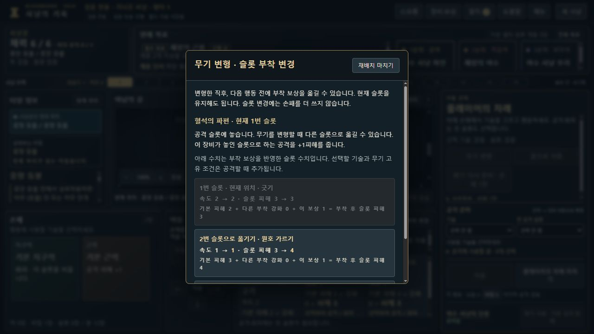
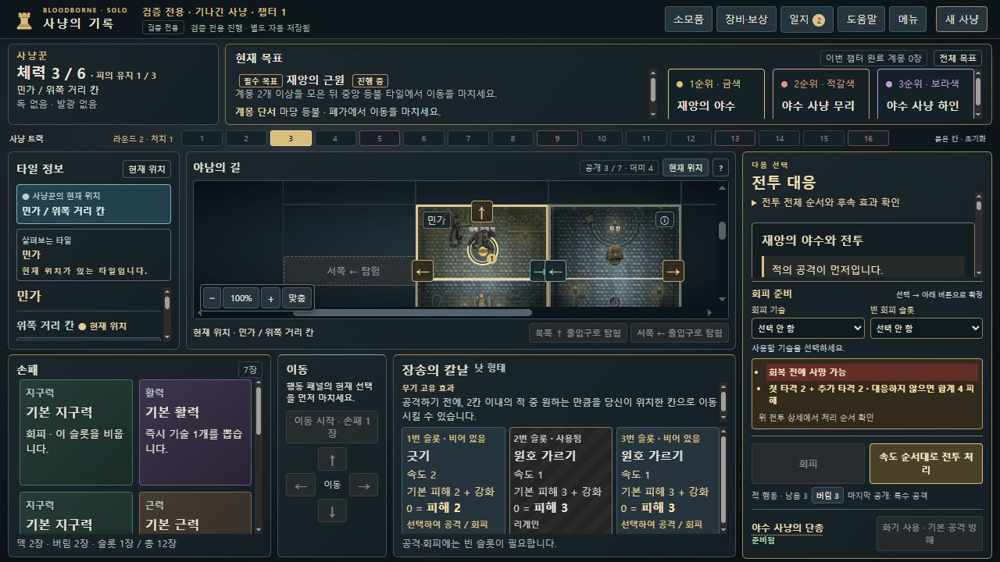
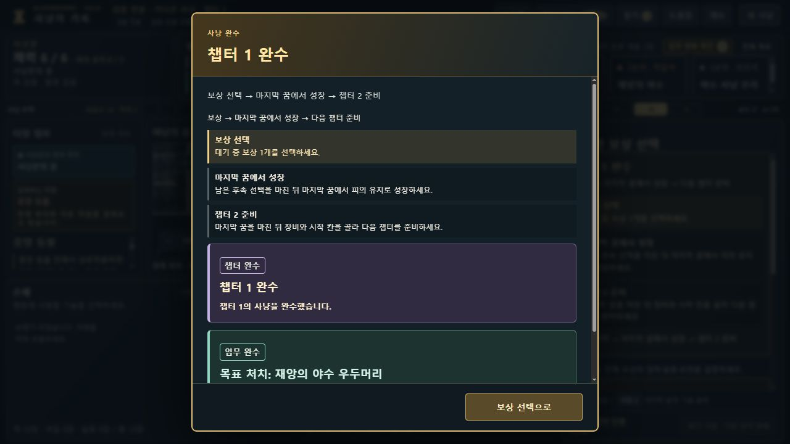
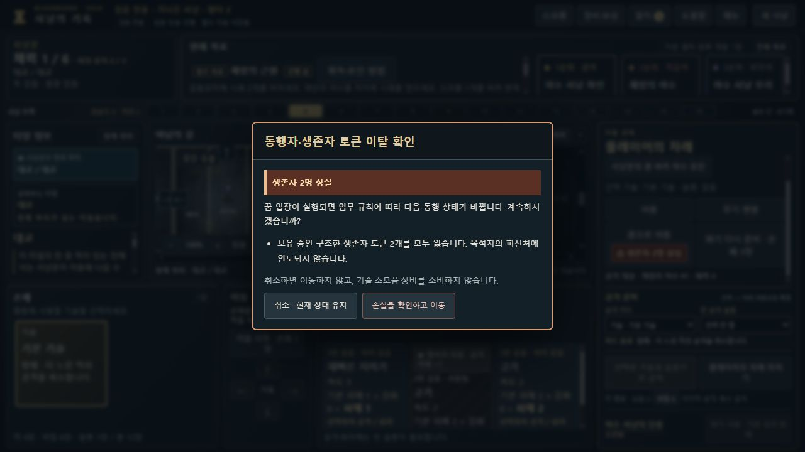

# 전투·임무 안내와 이동 손실 확인 · dev.14

개발본 점검 기록입니다. 정식 릴리스·전체 장치무기 재검증·스프라이트 전프레임 검토 완료를 뜻하지 않습니다. 기존 개인 플레이 저장을 검증용 사냥으로 교체하지 않습니다.

관리: [Issue55](https://github.com/dfrpg98-jpg/bloodborne-solo/issues/55). 아래 ID는 재현 예시와 함께 보존합니다.

## 확인한 문제와 구체적인 재현

| ID | 재현 예시 | 수정한 동작 |
|---|---|---|
| BB-043 | 체력 3에서 느린 리게인 공격을 선언하고 재앙의 야수의 다단 가르기 2+2를 처리하면, 첫 피해 후 체력 1이고 추가 피해로 치유 전에 사망합니다. 기본 피해 2만으로 판단하기 어려웠습니다. | 공개된 전투의 합계 피해·첫 타격/추가 타격/플레이어 공격 순서·회복 전 사망 가능성을 표시합니다. 토큰 부활·최종 처치 후 반응도 함께 예고합니다. |
| BB-044 | 지구력 카드로 손톱자국을 사용하면 원래 슬롯 비우기 효과가 사라지는데 카드·슬롯·룬·확정 버튼이 멀리 떨어져 있었습니다. | 같은 선택 상태를 공유하는 고정 카드/빈 슬롯 선택기와 적용 효과를 확정 버튼 위에 모읍니다. 대체된 원래 카드 효과는 미적용으로 표시합니다. 슬롯은 기본 피해+부착 강화 수치를 나눕니다. |
| BB-045 | 챕터 2의 ‘공동묘지에 시체 2개’만 읽고 하인을 처치해도 시체가 생기지 않습니다. 기존 완료 후 패널은 있지만 최초 완료 알림은 일반 변경과 비슷했습니다. | 이미 공개된 카드18의 재앙의 야수 유인·처치 방법과 실제 사용 가능한 유인 행동을 연결합니다. 필수 목표와 계몽 선택 임무를 나누며 최초 챕터 완수 전용 강조와 보상→마지막 꿈 성장→다음 준비 단계를 표시합니다. 이야기 닫기는 실제 복귀 패널 이름을 씁니다. |
| BB-046 | 파편을 옮길 때 ‘2번 슬롯’만 보여 어느 공격인지 알 수 없었습니다. | 최초 장착·필수 재장착·선택 재배치에 공격명·속도·현재/부착 후 피해·다른 부착 강화·슬롯 설명을 표시합니다. 예: 돌망치의 덩어리가 있는 피해5 공격에 파편을 옮기면 피해6입니다. |
| BB-047 | 메뉴에서 정상 저장을 불러와도 메뉴가 계속 열려 게임을 가렸습니다. | 정상 채택 뒤 메뉴를 닫습니다. 취소·오류는 현재 진행과 열린 메뉴를 보존합니다. |
| BB-048 | 소검의 파편1번·덩어리3번 상태에서 꿈을 거쳐 돌망치2슬롯으로 귀환하면, 밀려난 덩어리만 재장착하고 유효한 파편을 옮길 기회는 없었습니다. | 반대 면 귀환에서 재배치 기회를 열고, 필수 재장착 뒤 선택 재배치 창을 엽니다. 유지·이동 모두 추가 카드 비용이 없습니다. |
| BB-049 | 무리의 기본 공격을 지구력으로 회피한 뒤 단총을 눌러도 화기 준비가 소진됐습니다. | 회피한 동일 기본 공격에 순수 방해 화기를 중복 사용하는 새 UI 선택을 차단합니다. 로즈마리누스로 독립 추가 타격을 없애는 사용은 유지합니다. |
| BB-050 | 수집 생존자 2명을 가진 채 꿈으로 들어가면 보유 인원이 0명이 되지만 실행 자리에서 손실을 놓치기 쉬웠습니다. | 꿈·중앙 등불·휴대용 등불·순간이동 소모품에 공개된 동행 이탈 결과를 표시하고 비용 지불 전에 확인합니다. 취소·ESC는 진행과 자원을 그대로 보존합니다. |
| BB-051 | 피의 기쁨의 실제 효과는 손패 카드1장 뽑기인데 장비 패널에는 ‘장비 1개를 뽑습니다’로 표시됐습니다. | 명시 종류가 없는 손패 뽑기 문구를 일반 카드 용어 치환 전에 구분합니다. 보상·소모품·화기·행동 등 명시된 카드 종류는 유지합니다. 실제 장비를 새로 받는 것으로 설명하지 않습니다. |

## 판정과 해석의 경계

- 전투 예고는 공개된 임무·적 능력·현재 공개 행동만 사용합니다. 공격 선언 전에 다음 적 행동을 덱에서 미리 읽거나 확정하지 않습니다. 회피·방해·방어·이동·면역에 따라 결과가 달라짐을 명시합니다.
- 다단 추가 타격은 첫 공격을 회피하거나 방해해도 별도의 대응이 필요합니다. 이미 첫 피해가 처리된 추가 타격 단계에서는 첫 피해를 다시 합산하지 않습니다. 동시 최종 처치로 적 피규어가 사라져도 예약된 추가 타격은 표시합니다.
- 수집 생존자 소실, 민가·대교 호위 생존자의 원위치 복귀, 실험 생존자의 출발 칸에 떨어짐, 구원 NPC의 현재 칸 잔류를 구분합니다. 시체와 붙잡지 않은 생존자는 손실로 세지 않습니다. 실제 손실 규칙은 바꾸지 않습니다.
- 귀환 재배치는 한국어 규칙서24쪽의 귀환 시 장치무기 면 선택과 제공된 혈석 카드의 ‘무기를 변형할 때 다른 슬롯’ 문구를 조합한 해석입니다. 공식 FAQ의 별도 판정이라고 주장하지 않습니다. 같은 면으로 귀환하는 것만으로 새 재배치 기회를 열지 않습니다.
- 새 귀환 UI는 반대 면일 때 RETURN 명령에 reassignAttachments:true를 기록합니다. 이 필드가 없는 과거 명령은 수정 전과 바이트까지 같은 상태로 재생합니다. 귀환으로 화기 무료 준비·토니트루스 충전 등 별도 변형 발동 효과를 새로 주지 않습니다. 저장 schema는 유지하고 선택 명령 필드를 원형 그대로 보존합니다.
- 회피 후 무의미한 화기 소모 차단은 새 UI 경계에 적용합니다. 과거 저장에 기록된 화기 명령을 소급 거부하지 않습니다. 소모품의 공격 동시 사용은 행동 공개 전 확정되며 회피 후 새로 소모하지 않습니다. 중복 회피·유골은 기존 엔진이 이미 차단합니다.

## 검증 방법

처음 완료된 전체 검사에서는2880개 중18개가 실패했습니다.13개는 새 HTML 속성을 처리하지 못한 기존 목표 추출식과 이전 목표 문구 때문이었고,5개는 현재 UI가 반대 면 귀환에 새로 기록하는 명령 필드를 기존 재생 도우미가 반영하지 못한 경우였습니다. 목표의 미공개 정보 차단 검사는 유지하며 추출식·공개 문구 기대값을 갱신했습니다. 귀환 도우미는 실제 UI를 누를 때의 반대 면 RETURN에만 명시 필드를 투영하며, 임의 상태 필드를 지워 비교를 통과시키지 않습니다. 원래 저장의 무플래그 재생 검사는 그대로 유지합니다. 이후 최종 전체 검사를 다시 완료했으며, 아래에 결과를 기록했습니다.

검증용 캠페인과 공개 명령으로 만든 정상 저장을 별도 주소8811에서 불러왔습니다. 생존자·체력·손패·적·행동 덱을 수동 편집하지 않았습니다. 새 다단 재현은 tests/fixtures/v0813-dev14-followup-regain-legal-commands.json의 실제24명령이며, 꿈의 성장으로 리게인을 획득합니다. 챕터 완수·유인은 기존 자연 patient trace를 검증 모드의 빈 직접 지급으로 재생했습니다.

실제 브라우저에서는 메뉴 정상/오류 불러오기, 이름 있는 혈석 재배치, 반대 면 귀환의 필수/선택 재배치, 다단2+2와 치유 전 사망, 회피 후 단총 준비 보존, 로즈마리누스의 유효한 추가 타격 제거, 최초 챕터 완수와 보상 복구, 챕터2 유인 안내·실행, 생존자2명 꿈 이동의 취소/확인을 점검했습니다. 상세 테스트 수와 배포 확인은 최종 검증 결과에 별도로 기록합니다.

## 제공된 저장의 대교·안개 추격 조사

이 조사는 검증용 모드 플레이와 구분합니다. 사용자가 제공한 일반 진행을 격리된8811 주소에 불러와 공개 상태를 확인하고, 원래 파일은 변경·업로드하지 않았습니다.

- 챕터2에서 이미 39번 ‘불길한 경고’를 얻었습니다. 챕터3의53번은 38번 또는39번 보유 시54번으로 이어집니다. 제공된35·53·54번 실물 사진과 전사 원문을 대조했습니다.
- 35번은 대교에 안개와 지정 적을 만드는 분기입니다. 이번54번은 재앙의 야수 처치 토큰을 처리하는 다른 분기이며, 안개를 만들지 않습니다.
- 실제334번째 명령 STOP_MOVE에서 재앙의 야수 추격 뒤53→54번이 공개됐습니다. 전후 모두 안개 목록은 오에돈의 지하묘지만 포함하고 대교는 포함하지 않았습니다. 브라우저의 대교에도 안개 클래스·안개 표시는 없었습니다.
- 따라서 이 저장에서는 추격 제거·차단 누락이 확인되지 않았습니다. 실제 안개 형성 시 일반 적 제거와 외부 적 진입 차단이라는 규칙은 유지합니다. 35번과54번을 구분하는 별도 회귀 검사로 정상 동작을 보존합니다. 정상 사례를 확인된 오류 ID에 추가하거나 규칙을 바꾸지 않습니다.

## 최종 전체 검사

2026-10-16 KST에 로컬 `node scripts/test-ci.cjs`를 완료했습니다. **2885개 통과, 실패·취소·건너뜀 0개**, 소요 780.698초입니다. 검사 전후 런타임·자산·스크립트·테스트 587파일의 해시가 같았습니다. [전체 결과](full-ci-result.json)에 범위와 제외 항목을 기록했습니다. 원본 사진에 의존하는 4개 검사는 CI 실행 대상에서 명시적으로 제외했으며, 이들을 통과했다고 주장하지 않습니다. 원본 사진 보존은 로컬 배포 전후 별도 검사로 확인합니다.

실제 브라우저 검증의 개별 항목과 화면은 [브라우저 기록](browser-verification.json), [캐시 해시](cache-hashes.json)에 있습니다. 전체 검사와 겹치는 개별 테스트 수를 더해 부풀리지 않았습니다.
