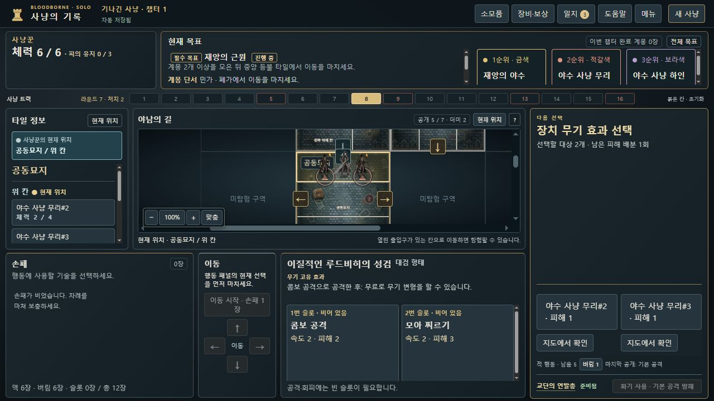

# 여러 피해 배분 진행 표시 · 0.8.13-dev.22

BB-068 / [Issue #69](https://github.com/dfrpg98-jpg/bloodborne-solo/issues/69). 이질적인 루드비히의 성검으로 점유 슬롯2개를 비웠을 때, 후보가2명인 화면은 첫 선택 전후 모두 ‘선택할 대상2개’였습니다. 피해는 제대로 적용됐지만 남은 배분을 알기 어려웠습니다.

현재 후보 수는 유지하면서 **남은 피해 배분2회→1회→완료**를 표시합니다. 현재 공개된 연속 피해 중 피해량·범위·대상이 같은 묶음만 셉니다. 이동·밀기·전체 피해·다른 범위/대상/피해량에서 끊으며, 남은 수를 필요한 클릭 수로 보장하지 않습니다. 한 적이 죽어 후보가 한 명이면 다음 피해가 자동 적용될 수 있습니다.

완료 문구는 마지막 실제 피해 선택의 `enemyId`와 다음 `hunter` 단계에서만 표시합니다. 다음 행동에서는 사라지고 새로고침으로 되살린 동일 완료 상태에서는 유지됩니다. 기존 정책 채택 명령은 실제 선택과 구분합니다. 산탄총 밀기의 `node`/`stop` 선택 후에는 나오지 않습니다. 새 UI 상태·게임 명령·저장 필드를 추가하지 않았습니다.

처음부터 후보가0명/1명이라 선택 화면 없이 전부 처리되는 경우에는 새 완료 문구를 추가하지 않았습니다. 이번 완료 표시는 피해 대상을 실제 선택한 흐름에 한정됩니다.

## 정상 플레이 원본과 로컬 직접 재생

부모가 cloud8773의 dev.21 정상 UI 플레이에서 내보낸 원본3개를 전달했습니다. 출처는 부모의 보고이며, 이 작업에서 직접 확인한 범위는 **받은 파일의 해시·엄격 재생과 로컬 브라우저에서 동일 구간을 조작한 결과**입니다. 새 일반 캠페인 완주가 아닙니다. 원본은 `qa`/`practiceTarget` 설정이 없는 일반 저장이며 SYNTHETIC-QA로 분류하지 않습니다.

전달 ZIP은15,761바이트, SHA-256 `f8a2fcef2c7ac87e33bcd0e81e106ffdd380415216a40908c23c7720fa815134`입니다. 로컬 원본 폴더는 수정하지 않았습니다. 아래 파일은 읽기용 복사본과 실제 이번 UI 내보내기이며, [대조 결과](native-verification.json)에 전체 크기·SHA-256·명령 수가 있습니다.

| 순서 | 공개 UI 조작 / 기대 표시 | 저장·결과 |
| --- | --- | --- |
| 시작 | [정상 원본 복사본](inputs/normal-parent-before-transform.json) 불러오기. 기본 활력 선택→무기 변형 | 81→82명령. 두 슬롯 비우기, HP6 유지 |
| 2회 | `선택할 대상2개 · 남은 피해 배분2회` | [내보내기](native/normal-two-remaining.json) 31,542바이트, 전달 pending 원본과 전체 바이트 일치 |
| 1회 | 무리#2 피해1 버튼 선택. `선택할 대상2개 · 남은 피해 배분1회` | [내보내기](native/normal-one-remaining.json) 31,645바이트, #2 HP3→2, #3 HP2 유지 |
| 완료 | 무리#3 피해1 버튼 선택. `피해 배분 완료` | [내보내기](native/normal-complete.json) 31,629바이트, #3 HP2→1, #2 HP2·사냥꾼HP6 유지. 전달 result 원본과 전체 바이트 일치 |

각 내보내기는 엄격 불러오기→재내보내기로도 바이트가 같습니다. 다음 차례 마치기를 실행하면 완료 문구가 사라지고 적 활성화 안내로 넘어갔습니다. 새로고침 직후 동일 완료 상태는 유지됐습니다.

`지도에서 확인`을 눌렀을 때 해당 적 하나만 이름·체력 HUD가 나타났고, 첫 피해 적용 뒤에는0개였습니다. 선택하지 않은 모든 적에게 HUD를 표시하지 않습니다. 이 관찰과 [선택 HUD 회귀](../../../tests/playtest-target-selection-ui-v0818.test.cjs)를 구분합니다.

[2회 대기](evidence/normal-two-remaining.jpg) · [완료](evidence/normal-complete.jpg).

## SYNTHETIC-QA와 회귀 검사

[공개 생성·명령 도우미](../../../tests/helpers/damage-allocation-qa.cjs)는 seed6의 검증 모드에서 시작합니다. QA 소모품·보상 없이 이동→탐험→배치→진입→슬롯 두 개로 실제 전투→변형에 도달합니다. 직접 상태 수정은 없습니다. [변형 직전 입력](inputs/SYNTHETIC-QA-before-transform.json)에서 `card-2`를 선택하고 변형하면 후보2개/배분2회이며, 무리→하인으로 각각 배분해2→1→완료를 재현할 수 있습니다. 이 생성 자료를 정상 플레이 원본과 합치지 않습니다.

자동 처리 경계는 시작 지급에 발화 부싯깃1개를 추가하고 실제 두 번째 공격에 사용해 하인HP1을 남깁니다. [SYNTHETIC-QA 자동 처리 입력](inputs/SYNTHETIC-QA-auto-final.json)을 UI로 불러오면2회 대기이고, 하인에게 한 번만 배분하면 처치 후 남은 무리에 다음1피해가 자동 적용되어 즉시 완료됩니다. 무리HP4→3·사냥꾼HP2 유지, [실제 내보내기](native/SYNTHETIC-QA-auto-complete.json)와 [화면](evidence/SYNTHETIC-QA-auto-complete.jpg)을 보존합니다. 완료 뒤 기존 `APPLY_TILE_SPEED_RULING` 마이그레이션이 한 번 추가되어, 원시 입력에 선택 명령만 더한 파일 대신 기존 마이그레이션까지 적용한 기준과 바이트를 대조했습니다.

[최종 관련75/75 통과](focused-tests.json), [원시 출력](focused-tests.tap), [재실행](run-focused.cjs). 신규 UI 검사4개는 이75개에 포함되며 과거 dev.21 결과와 합산하지 않습니다. 전체 CI 수치가 아닙니다.

- 실제 변형·선택2회·비용·저장·선택한 적만 HUD·다음 행동에서 완료 해제.
- 첫 피해로 적 처치→다음 피해 자동 적용, 추가 클릭 없이 완료.
- 다른 종류/수치의 효과를 남은 배분으로 세지 않는 표시 경계. 이 경우만 인위적인 component 상태이며 브라우저 불러오기 입력으로 사용하지 않습니다.
- Uncanny에 공개 `firearmOverride`로 산탄총을 조합한 실제 밀기→플레이어 차례. 피해 배분 완료 오표시 없음. 다른 무기의 단일 피해 선택과 말뚝박이 밀기 문구도 관련 검사에서 유지됩니다.

검사 중 제품·검사 파일17개 해시가 유지됐고, 엔진·무기 흐름·무기 규칙 등7개 파일은 dev.21 커밋 `8d379508aff059d6c4ca05382be44437867db54d`와 해시가 같습니다. [정상/네이티브 대조 스크립트](verify-native.cjs)는 원본 해시와 각 단계 명령의 전체 결과를 재확인합니다.

## 검토 범위

별도 `127.0.0.1:8823`에서 일반 파일 선택기·카드 선택·변형·피해 선택·메뉴 내보내기를 사용했습니다. 개인8786/8815 저장은 열지 않았습니다. 임시 탭·서버는 검증 뒤 정리했습니다. 장치무기 계산·판정·비용·명령·저장 형식·스프라이트에는 변경이 없습니다. 브랜치 `fix/damage-allocation-progress-dev22`에서 검토하며 병합·배포하지 않습니다.
