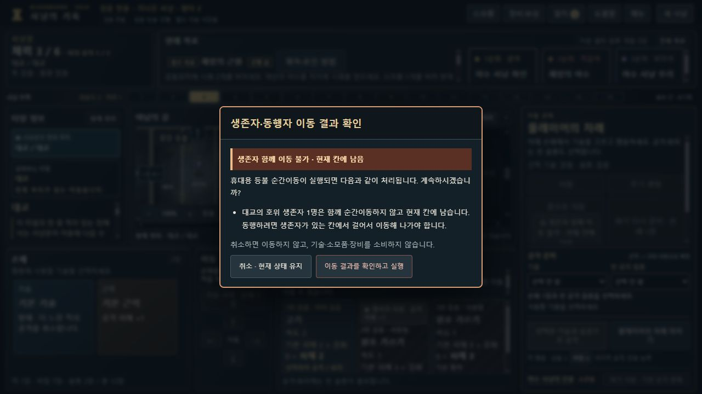

# 생존자·랜턴 순간이동 안내 점검 · 0.8.13-dev.16

대교 생존자와 같은 칸에서 랜턴으로 예배당에 이동했는데 생존자가 대교에 남았다는 피드백을 검토했습니다. **생존자가 함께 순간이동하지 않는 판정은 정상이며, 같은 칸의 미동반 생존자에 대한 사전 안내가 누락됐습니다(BB-058).**

원래 클라우드 관찰의 `carrierId`는 확정되지 않았습니다. 부모 클라우드에만 있는 `dev15-lantern-leaves-escort.jpg`를 로컬에서 열었다고 주장하지 않습니다. 이 기록은 공개 명령으로 만든 별도 QA 상태와 로컬 실제 브라우저 재현을 근거로 합니다.

관리: [Issue #59 · BB-058](https://github.com/dfrpg98-jpg/bloodborne-solo/issues/59).

## 규칙과 현재 처리

제공된 임무 8·37번 원본 사진과 전사문을 대조했습니다. [8번](../../../campaigns/long-hunt/data.json)의 토큰을 가진 사냥꾼이 순간이동하거나 꿈에 입장하면 민가로 돌려놓고, [37번](../../../campaigns/long-hunt/data.json)은 대교의 보라색 손 출현 칸에 재출현시킵니다. [랜턴 원문](../../../components/cards.json)은 등불 칸으로 순간이동하는 효과이며, 호위 임무에 대한 예외는 없습니다.

| 출발 시 상태 | 실행 결과 | 확정 전 안내 |
|---|---|---|
| 같은 칸에 있지만 미동반(`carrierId:null`) | 생존자는 현재 칸에 남음 | 새 ‘생존자 함께 이동 불가 · 현재 칸에 남음’ |
| 동행 예약만 선택(`pickup:true`, 미동반) | 현재 칸에 남고 예약 해제 | 위와 같은 새 잔류 안내 |
| 이미 동행 중(`carrierId`가 사냥꾼) | 임무에 지정된 원래 출현 칸으로 복귀 | 기존 ‘민가/대교 생존자 원위치 복귀’ 유지 |

`rewards-engine.js`의 랜턴은 `hunt-engine.teleport()`를 거쳐 `mission-engine.onTeleport()`를 호출합니다. 미동반 토큰의 위치는 바뀌지 않고, 동행 중인 토큰만 원위치로 복귀합니다. 걷기 동행은 `hunt-departure.js`의 STEP/EXPLORE 질문과 `mission-engine.onStep()`에서 처리합니다. **이번 변경에는 판정 엔진·임무 규칙·자동 동행·저장 형식 수정이 없습니다.**

## 수정 범위와 재현 예시

- `hunt-action-loss.js`: 기존에는 `carrierId === activeHunterId`인 토큰만 검사했습니다. 이제 무료 호위 토큰(`escort`)이 현재 칸에 있고 미동반일 때도 순간이동·꿈 입장 전에 잔류 안내를 표시합니다. 동행 중의 복귀 안내와 서로 배타적으로 처리하며, 같은 목적지에는 새 잔류 안내를 만들지 않습니다.
- 실행 버튼 옆의 예고와 기존 확인창을 공유합니다. 취소가 기본 초점이며, 취소·Esc는 비용·상태를 바꾸지 않습니다. 확인창 제목과 확정 버튼은 잔류도 포함하도록 ‘이동 결과’로 표현했습니다.
- `hunt-context.js`와 이동 단계 설명: ‘걸어서 이동해 나갈 때’ 동행 질문이 열린다는 점과 순간이동·꿈 입장에는 함께 이동하지 않는다는 점을 명시합니다.
- 다른 칸의 미동반 토큰, 호위 완료 상태, 상호작용이 필요한 별도 구조/실험 생존자, 미선택 구원 NPC에는 새 무료 호위 안내를 확대하지 않습니다. 꿈 귀환 RETURN에 경고를 반복하거나 동행 질문을 추가하지 않습니다.
- 변경한 3개 JavaScript에 dev.16 버전과 실제 SHA256 캐시 구분을 붙였습니다.

재현 예: 대교 수호자를 처치한 뒤 생존자와 같은 `tile-18:top`에 서 있지만 아직 도보로 데리고 나가지 않은 상태에서 랜턴 목적지로 **오에돈 예배당(`tile-17:top`)**을 선택합니다. 수정 전에는 동행 손실 예고·확인 없이 사냥꾼만 이동했습니다. 수정 후에는 ‘함께 순간이동하지 않고 현재 칸에 남습니다’라는 설명을 먼저 확인합니다. 수락 후에도 생존자는 대교에 남고 예배당 인도 인원은 증가하지 않습니다. 이 상태를 토큰 소멸이나 원위치 복귀로 잘못 설명하지 않습니다.

## 실행한 검증

관련 11개 파일 **118/118 통과**, 실패·생략 0개입니다. [명령·파일 해시·결과](regression-results.json), [TAP 원문](regression.tap). 전체 CI를 새로 실행한 결과나 원래 dev.15의 2928개 검사와 합산한 숫자가 아닙니다.

- 신규 핵심 27개: 민가·대교 × 미동반/예약/동행 중 × 꿈/랜턴/뚜렷한 증거의 18조합과 공개 예고의 순수성·잘못된 명령·원격/완료/유료 구조·일반 도보·중앙 등불·꿈 귀환 경계. 민가 신규 시작은 규칙 버전14, 과거 자연 명령 이력은 버전13 호환 경로로 확인했습니다. 같은 목적지 필터 1건은 명시된 무변화 어댑터 단위 검사이며 실제 합법적 랜턴 플레이로 세지 않습니다.
- 신규 UI 5개: 실제 컨트롤러 핸들러와 실제 엔진 저장으로 3가지 호위 상태의 랜턴 예고·취소·재확인·정확히 한 번 실행, 꿈의 카드 선택 전 안내·Esc, 뚜렷한 증거의 소모품 화면 복귀와 자원 보존을 검사했습니다.
- 기존 손실/호위/동행 질문/대상 비용/안개 등불/꿈 혈석 회귀를 함께 실행했습니다.

로컬 **Codex 실제 브라우저·격리 주소 8816**에서 정상 파일 선택기로 아래 QA 파일을 불러왔습니다. 내부 상태 주입이나 localStorage 쓰기는 사용하지 않았습니다.

1. 미동반 생존자: 랜턴 예고 → 예배당 선택 → 확인창 → 취소 → 저장 내보내기. 원본 입력과 **모든 바이트 동일**, 랜턴 준비 유지.
2. 같은 상태에서 다시 실행 → 예배당 도착, 생존자 대교 잔류·랜턴 소진·인도 인원 불변.
3. 동행 예약 상태에서 같은 랜턴 실행 → 예배당 도착, 생존자 잔류·예약 해제.
4. 이미 동행 중인 상태 → 기존 원위치 복귀 설명 → 예배당 도착, 생존자 대교 원위치 복귀.
5. 미동반 생존자의 지도 설명을 확인하고 손패를 선택 → 꿈 입장 경고 → 실행 → 꿈 도착·생존자 대교 잔류.

수락한 실제 행동 **4개**에서 내보낸 전체 상태가 같은 공개 명령의 엔진 결과와 일치하고 엄격한 저장 재불러오기도 통과했습니다. 네이티브 꿈 귀환·뚜렷한 증거를 새로 플레이했다고 세지 않으며, 해당 경로는 위 자동 검사 범위입니다. [네이티브 결과](native-verification.json)는 3개의 랜턴 결과, 꿈 결과, 취소 결과의 해시와 실제 저장을 연결합니다. 실제 화면의 새 3개 스크립트 버전/해시도 확인했고 오류 콘솔 기록은 0개였습니다.

[예배당 도착·대교 잔류](evidence/bridge-ground-after-lantern.jpg), [동행 예약 상태](evidence/bridge-armed-confirm.jpg), [이미 동행 중인 상태](evidence/bridge-carried-confirm.jpg), [꿈 이동 안내](evidence/bridge-ground-dream-confirm.jpg), [지도 대상 설명](evidence/bridge-escort-context.jpg).

## 독립 클라우드 UI 검수 보고 · 2026-10-16

별도 클라우드 **8768**, 대상 커밋 **`f97ec6f206826f23d6929ea2c335a340038fe590`**에서 수행한 관찰 결과를 전달받아 반영했습니다. 아래는 위의 로컬 실행과 별도인 보고이며, 이번 문서 반영 중 로컬에서 다시 실행하거나 원본 클라우드 화면을 열어 확인한 결과가 아닙니다. [구조화된 보고·한계](independent-cloud-ui-verification.json).

합성 QA 저장을 정상 불러오기로 열어 **같은 칸의 미동반 생존자**, **이미 운반 중인 생존자** 두 상태를 각각 확인했습니다. 두 경우 모두 장비 사용 버튼과 확인창의 경고가 상태에 맞게 구분됐습니다. 취소하면 화면상 사냥꾼 위치·손패·랜턴 준비·운반 상태가 유지됐습니다. 확정하면 사냥꾼만 예배당으로 이동하고, 미동반 생존자는 제자리에 남으며, 운반 중인 생존자는 대교의 원래 출현 칸으로 복귀했습니다.

추가 보고에서는 **동행 예약(`armed`) 상태의 랜턴**도 현재 칸 잔류 경고 → 취소 → 재실행의 안내와 처리가 일치했습니다. 이 사례는 취소 후 정상 저장 내보내기 UI로 얻은 파일이 원본 합성 QA 저장과 **바이트 단위로 동일**하다고 확인됐습니다. 이 바이트 검증은 예약 상태의 해당 취소 사례에만 해당하며, 앞선 미동반·운반 중 랜턴 취소는 여전히 화면상 보존 확인입니다.

**미동반 생존자의 꿈 입장**도 경고 → 취소 후 손패 2장 유지 → 재확인 → 꿈 입장과 생존자 대교 잔류까지 독립 확인됐습니다. 이 꿈 취소에 대해서는 저장 바이트·전체 상태 동일성을 확인하지 않았습니다. 위 결과는 모두 합성 QA이며 일반 플레이 성과로 집계하지 않습니다. 기존 로컬118개 검사·네이티브4행동의 범위와 숫자도 유지하며 독립 검수와 합산하지 않습니다.

실제 플레이로 얻은 dev.15 중간 저장을 dev.16에 정상 불러와 기존 일반 진행으로 복귀했다는 보고도 받았습니다(보고 표현: ‘일반 2장 플레이로 복귀’). 이는 **기존 진행의 호환·복원 확인**이며, 새 챕터 완수나 합성 QA의 일반 플레이 성과로 집계하지 않습니다. 새 결함 보고는 없으며, 이번 반영은 문서만 변경하고 제품 코드·테스트·병합·배포는 수행하지 않았습니다.

## 재현 입력과 위치

이 파일들은 **합성 QA 상태**입니다. 등록된 검증 모드 설정과 실제 공개 명령만으로 재구성했으며, 임의 상태 편집이나 새 일반 캠페인 완주 결과가 아닙니다. 과거 자연 명령 trace의 분기 지점에 STOP_MOVE와 기존 정책 채택 명령을 적용했습니다. QA 시작 추가 보상·소모품은 빈 목록이고, 랜턴 등은 trace의 실제 보상 선택으로 획득합니다.

- [미동반](SYNTHETIC-QA-bridge-ground-before-lantern.json): 134명령, 대교 출현 칸에 사냥꾼·생존자, `pickup:false`.
- [예약](SYNTHETIC-QA-bridge-armed-before-lantern.json): 135명령, 같은 칸, `pickup:true`.
- [동행 중](SYNTHETIC-QA-bridge-carried-before-lantern.json): 135명령, 이미 도보로 데리고 나간 상태.

저장 준비를 검증하려면 `node docs/audits/escort-teleport-v0.8.13-dev.16/build-checkpoints.cjs`, 네이티브 내보내기를 대조하려면 `node docs/audits/escort-teleport-v0.8.13-dev.16/verify-native-exports.cjs`를 실행합니다. 첫 스크립트는 기본적으로 기존 파일과 바이트 일치만 검사하고 `--write`를 명시한 경우에만 재생성합니다.

수정본은 `fix/escort-teleport-warning-dev16` 브랜치입니다. 기존 `fix/playtest-ui-dev15`와 사용자 Desktop 배포본·8786 서버·개인 저장 파일은 변경하지 않았습니다. 병합·배포·정식 릴리스 완료를 의미하지 않습니다.
