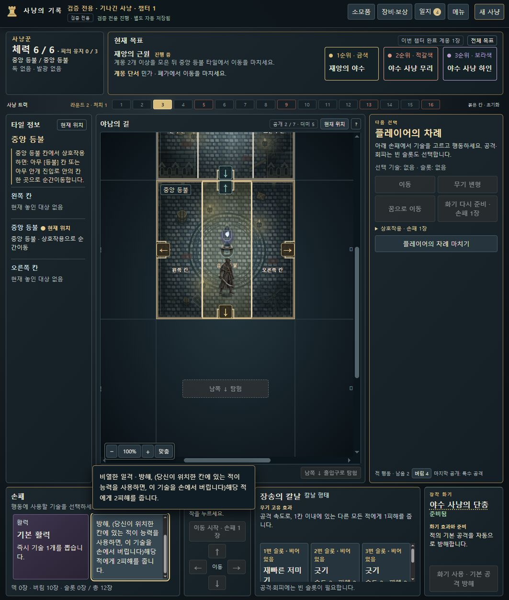
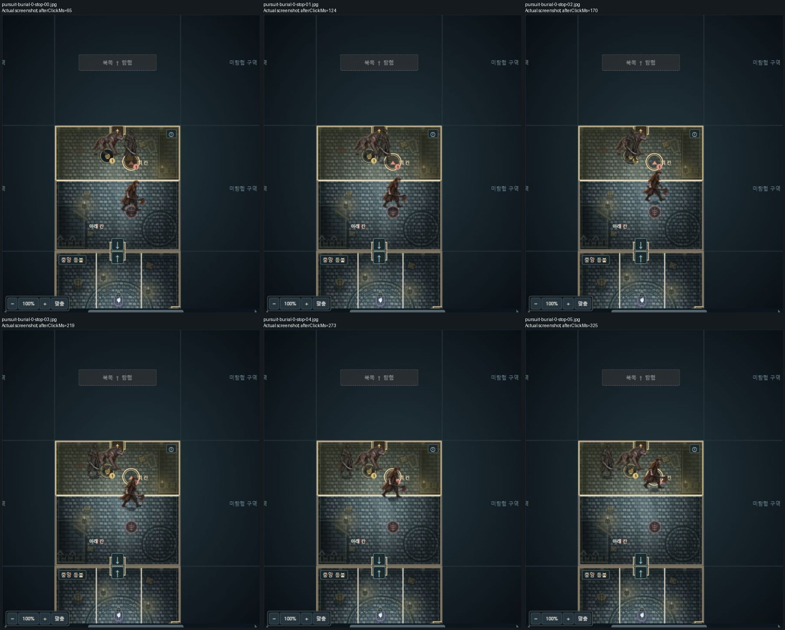
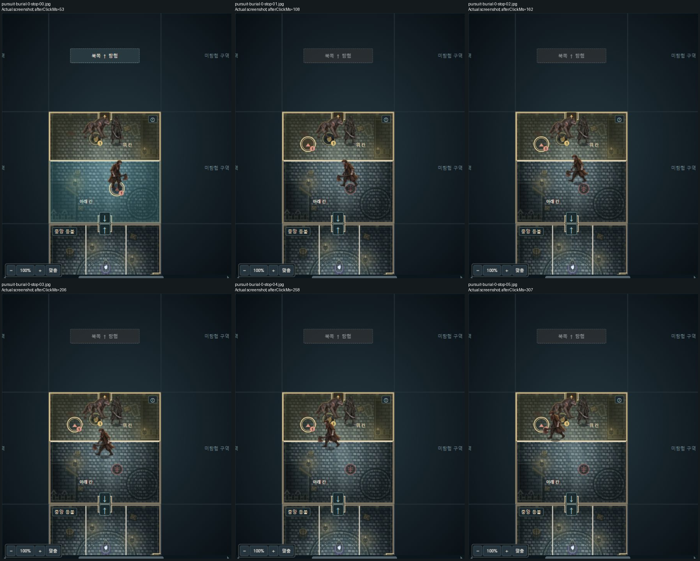

# 남은 로컬 검증 · 0.8.13-dev.8

2026-10-14. 현재 제품 커밋은 `b594de4a90f453cc16ab0468a3c81e02b298a5f3`이며, UI 1–12의 대표 실제 확인과 새 오류 BB-030·031의 수정 후 재검증을 완료했습니다. 기존 모션 영상 125개의 기록된 캐릭터 영역 시각 검토는 진행 중입니다. [진행표 Issue35](https://github.com/dfrpg98-jpg/bloodborne-solo/issues/35)에서 남은 항목을 구분합니다. main 병합·태그·릴리스는 하지 않았습니다.

## 실제 UI와 상태 대조

검증용 플레이모드의 정상 `create/dispatch` 명령으로 만든 시작점을 제품의 공개 파일 불러오기로 가져왔습니다. 준비 모델은 실제 UI 실행 수에 포함하지 않습니다. 브라우저 조작은 실제 제품 컨트롤을 사용했고, DOM 읽기는 화면 관찰에만 사용했습니다. 엔진 상태를 브라우저 내부에서 직접 수정하지 않았습니다.

| 피드백 | 실제 확인 | 결과와 범위 |
|---|---|---|
| 1 화기 능력 | 정상 획득한 루드비히의 장총 이름, 보상 선택 후 장착 이름의 실제 마우스 호버·키보드 초점 | 효과·손패2장 준비 비용과 화면 경계 확인. dev.7에서1208/848/390px, dev.8에서1208px 깨끗한 호버 재확인. |
| 2 타일 정보 | 중앙 등불, 예배당, 생존자·상자·적이 있는 공개 타일 | 능력·칸·대상을 표시하고 적 상세를 열 수 있음. |
| 3 이동 컨트롤러 | 손패 선택→이동 시작→방향→이동 종료, 한 방향의 두 출입 선택 | 분기 선택 전 이동비용·저장 변화 없음, 목적지를 고른 뒤 정상 이동. |
| 4 회전한 글자 | 예배당과 다른 회전 타일의 칸 이름 | 지도 그림과 무관하게 글자 방향 유지. |
| 5 재선택 취소 | 카드·빈 슬롯의 클릭, Enter·Space 재입력 | 선택/해제와 초점 유지. BB-030을 실제 재현하고 수정. |
| 6 손패 크기·스크롤 | 카드6장의 최대3열, 추가행, 정상 획득한 긴 카드 내부 휠 | 카드136px 유지, 마지막 행 접근, 긴 설명 전체 읽기 가능. 모바일1열의 두 행 스크롤은 별도 반응형 배치. |
| 7 사용 슬롯 | 전투를 해결한 뒤 사용 슬롯과 빈 선택 슬롯 | 사용됨·disabled·aria-disabled·pressed=false로 구분. 사용 슬롯을 선택 상태로 만들지 않음. |
| 8 글자·정렬 | 1208×1252,848×848,390×848의 대표 화면 | 손패·화기·전투 설명을 읽고 관련 스크롤에 접근. 모든 폰트/문장 조합을 전수 확인한 뜻은 아님. |
| 9 전투 정보 | 공격 비교→해결→기절 손패 비용→정상 차례 | 공격 이름·종류·속도·피해·추가효과·순서를 표시하고 후속을 계속함. |
| 10 임무 공격 변화 | 임무3·10·31·36 실제 트리거→알림→대상 상세 | 현재 임무의 교체 능력·조건과 계몽 수 표시. 알림 확인에 명령/비용이 추가되지 않음. |
| 11 이름 없는 타일 | 이름 없는 공개 타일05의 지도·정보·일지 | 임의 타일 이름은 표시하지 않고 칸 이름은 유지. |
| 12 적용 수치 | 예배당의 재앙의 야수 달려들어 뜯기 | 속도1→0과 예배당 이유를 적 상세·실제 전투 정보에서 확인. 피해4·기절·회피 불가 표시 후 정상 기절 비용까지 진행. |

UI 통합의 소스는 `ae1657e/dev.7`입니다. 이후 dev.8은 캐릭터 표시 자리 배치만 수정했으며, 별도의 실제8개 추격 경로와 화기 장착 호버를 현재 `b594de4/dev.8`에서 재검증했습니다. 36개 관찰 행을 36개의 독립 게임 시나리오라고 합산하지 않습니다. 실제 공개 내보내기 저장은 같은 시작점의 정상 행동 재생과 **모든 필드를 정확히** 비교했습니다. 원시 QA 저장은 로컬에만 보존합니다. 개별 소스와 수는 [상태 대조 요약](evidence/actual-save-comparison.json)에 있습니다.

## BB-030 · 설명 위치·키보드 초점 소실

재현 예시: 정상 획득한 비열한 일격을 끝까지 스크롤한 뒤 클릭하면 선택은 되지만 설명의 scrollTop이50→0이 되고 초점이 BODY로 사라집니다. 빈 무기 슬롯도 Enter로 선택하면 초점이 없어 다음 Enter로 취소할 수 없습니다. 카드/슬롯의 DOM을 재생성하면서 현재 초점과 스크롤을 버리는 원인이었습니다.

`ae1657e/dev.7`은 여전히 존재하는 활성 카드·슬롯의 초점과 내부/구역 스크롤을 복원합니다. 소모되어 사라진 카드나 사용 슬롯에는 초점을 복원하지 않습니다. 카드 전체 설명의 별도 호버/키보드 팝업도 추가했습니다. 실제 휠, Enter·Space 선택/취소, 설명 위치 유지, Escape로 팝업 닫기를 재확인했습니다. 의미 있는 새 회귀6개와 관련59검사, dev.7 전체2675검사가 통과했습니다. [Issue41](https://github.com/dfrpg98-jpg/bloodborne-solo/issues/41).

## BB-031 · 적 추격으로 정지한 사냥꾼이 다른 적을 가로지름

재현 예시: tile01 위 칸에 금색 마커의 재앙의 야수와 사냥꾼이 있고, 아래 칸의 적갈색 야수 사냥 하인이 이동 종료 후 위 칸으로 추격합니다. 위 칸에 적갈색 출현 마커가 없으므로 하인이 빈 오른쪽 자리를 먼저 차지하고, 정지한 사냥꾼이 오른쪽 `[61,29]`에서 왼쪽 `[23,29]`로 재배치됩니다. 240ms 자리 보간 중 사냥꾼 몸통이 정지한 야수 몸통을 가로질렀습니다. 엔진 칸 이동이나 규칙상 순간이동 오류와 구분합니다.

`b594de4/dev.8`은 정확한 인쇄 마커의 첫 점유자→사냥꾼→나머지 이동한 적 순으로 표시 자리를 확보합니다. 공개 표시 배열 순서, 적의 실제 이동, 행동 비용·규칙·저장 명령은 유지합니다. 수정 전 실패한 동일 검사에서 타일 네 회전의 사냥꾼·고정 적 좌표 유지와 최종 몸통 분리를 확인했습니다. 관련62검사와 전체2676검사가 통과했습니다. 창을 닫은 실제8개 추격 경로의176장 지도 픽셀을 모두 확인했고, 사냥꾼 자리 유지와 정착 분리를 확인했습니다. 걷는 적의 머리가 앞쪽 다리를 잠깐 가리는 정상 깊이 가림을 새 몸통 겹침 오류로 세지 않았습니다. [Issue42](https://github.com/dfrpg98-jpg/bloodborne-solo/issues/42).

수정 전후 지도 접촉표는 원본 화면에서 지도 부분만 **크기 변경 없이** 잘라 붙인 분석 자료입니다. 실제60fps 전체 동작을 촬영한 영상이라는 뜻은 아닙니다.

검증 도구의 촬영 폴더 오류도 보존했습니다. 첫 수정 후 프로필이 이전 폴더를 가리켜 수정 전 전체화면 JPEG22개의 이름을 재사용했습니다. 이미 생성된199장 수정 전 지도 원본픽셀 분석 자료와 원래 해시는 보존됐으며 나머지177장 전체화면 원본도 남아 있습니다. 이를 숨기거나 바뀐 사진을 수정 전 원본으로 표시하지 않습니다. 고정 ae1657e를 별도8790에서 실제 다시 실행해 새 전체화면22장을 확보하고, 공개 내보내기 상태가 정상 STEP·STOP_MOVE 결과와 정확히 일치함을 확인했습니다. 이 보충 화면은1280×720이며, 원래1208×1252와 동일 화면 크기라고 하지 않습니다. 임시8790 서버는 확인 후 종료했고8786은 dev.8을 유지했습니다.

## 자동 검사·원본 사진·Unity 준비

- dev.8 전체 CI: **2676개 통과, 실패/취소/생략0**, Node24.19.0,475.972초. [원본 결과](evidence/ci-dev8.json).
- CI에서 제외하는 로컬 원본사진 검사4개: 최신 고정 b594de4에서 별도4통과. 원본 사진을 복사·수정하지 않았습니다.
- Unity 준비물을 최신 고정 b594de4 원본에서 새 격리 폴더로 export→fixtures→현재 campaign→validation 재생성했습니다. 엔진39모듈/65명령/101에셋,76trace/14477명령, Node10검사, JSON Schema15863, C# primitive2337, 컴파일한 JSON 계약21검사가 통과했습니다.
- 오래된 dev.5 생성물은 발견 기록과 함께 보존했습니다. 최신 별도 생성물과 해시는 [이식 준비 요약](evidence/unity-preparation.json)에 있습니다. 실제 Unity Editor, 전체 C# reducer, 씬·스프라이트 모션은 구현/검증 완료로 표시하지 않습니다.
- 8786의 실행·문서314파일은 디스크/HTTP SHA가 일치하고, 개인 저장·참고자료188파일/280557345바이트는 원본 SHA가 유지됐습니다. 배포는삭제0이며 이전 변경 파일 백업을 보존합니다.

## 기록 영상 시각 검토 상태

125개 원본 영상의60463개 기록 프레임을 decode했습니다. 기본42(22292프레임)·초기66(31371)·추가17(6800)로 중복 없이 나눕니다. 일부 과거 실행/같은 프로필은 서로 다른 버전의 재실행 증거이며 독립 시나리오 수에 단순 합산하지 않습니다.

기록된 캐릭터 영역의 원래 RGB를 실제 열람합니다. 픽셀이 완전히 같은 영역만 같은 크기로 묶고 모든 PTS·발생 횟수·원본 해시를 유지합니다. 지도 축소 썸네일은 위치·카메라·가림·영역 밖 동선 확인에 쓰며 썸네일만으로 원래 크기 캐릭터를 검수했다고 하지 않습니다. 영역 밖 캐릭터와 녹화 전체화면 축소 예외는 원본 확대 확인을 따로 기록합니다. 닫힌 창에 가려진 모션은 통과로 세지 않습니다. 8개 추격 프로필의 늦은 도착 가림은 최신 실제 창 없는 재촬영으로 보충했습니다.

**전체125영상의 나머지 시각 열람은 진행 중입니다.** 새로 확정한 오류만 재현 예시와 함께 등록하며 녹화의 회색 여백·전체화면 재축소·계측 실패·선택 텍스트가 찍힌 촬영은 게임 오류와 구분합니다. 전체 지도 장식 픽셀, 실제 게임60fps 모두, 현재 dev.8에서125개 경로 전체 재실행 완료로 확대하지 않습니다.
