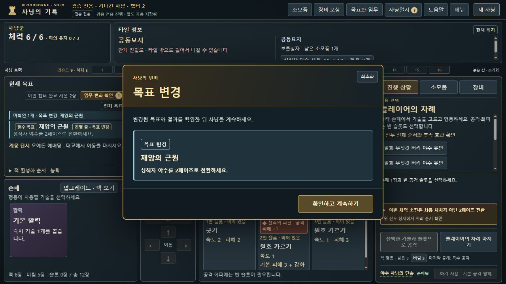

# 임무 안내창 행동 점검 · 0.8.13-dev.26

BB-076: ‘획득·유인 방법’ 창 안에서 유인·시체 바치기가 실행되지 않던 문제를 수정했습니다. [Issue #81](https://github.com/dfrpg98-jpg/bloodborne-solo/issues/81).

## 재현과 수정

챕터 2에서 소모품 1개를 보유하고 안내창의 ‘사혈 방울 버려 야수 유인’을 누르면, dev.25는 ‘열린 창을 닫거나 대기 중인 선택을 마치세요.’만 표시했습니다. 실제 로컬 브라우저에서 창이 열린 채 행동이 취소되는 것을 확인했습니다. 엔진이 유인을 거절한 것이 아니라 새 document capture 가드가 기존 ‘창 닫기 → 실행’ 처리에 도달하기 전에 차단했습니다.

등록된 `missionGuideDialog`가 유일한 열린 창이고 최소화되지 않았을 때, 그 창의 `MISSION_LURE`·`MISSION_CORPSES` 응답만 클릭 처리기로 연결합니다. 다른 창·최소화 창·배경 명령은 계속 차단하며 `canExecute`, 엔진, 비용, 저장 형식은 바꾸지 않습니다.

## 검증

- 신규 경계 회귀는 수정 전 실패했고 수정 후 통과했습니다. 유인·바치기, 다른 창 중첩, 최소화, 배경 동일 명령, 관계없는 내부 명령을 검사합니다.
- 신규 통합 회귀는 실제 안내 버튼의 capture → 기존 처리기 → 공개 명령 실행을 확인하고 별도 일반 저장의 보존을 대조합니다. 기존의 평면 UI 모의 DOM에는 capture·부모 관계가 없어 해당 버튼의 실제 소유 관계를 명시했습니다. 실제 브라우저 검사와 구분합니다.
- 관련 4파일 **38개 통과**, 신규 2개 포함. 전체 회귀 실행 결과·파일 해시·브라우저 저장 해시는 [verification.json](verification.json)에 기록합니다. dev.25의 과거 통과 수와 합산하지 않습니다.
- 최종 `node scripts/test-ci.cjs`: **148파일·3,126개 통과·실패 0**, 465.445초. 기존 CI 정책의 원본 사진 검사 4개는 실행 대상에서 제외되며 검증했다고 세지 않습니다.

실제 브라우저는 별도 검증용 origin `127.0.0.1:8830`을 사용했습니다. 사용자 원래 게임 저장은 건드리지 않았습니다. 원래 이력의 공개 명령을 검증 모드에서 재생한 **QA-HISTORICAL** 입력이며 새로운 일반 캠페인 완주가 아닙니다.

| 조작 | 실제 결과 |
| --- | --- |
| 안내창에서 유인 | 창 닫힘, 소모품 1→0, 살아 있는 적 3→4. 전체 내보내기가 공개 `MISSION_LURE` 결과와 바이트 일치 |
| 안내창 최소화 후 손패 선택·이동 시도 | 손패 확인 가능, 이동 차단, 전체 저장 바이트 보존 |
| 안내창 복원·닫기 후 이동 시작 | 정상 이동 단계·남은 이동력 2 |
| 메뉴창을 함께 열고 최소화한 뒤 시체 바치기 | 여전히 차단, 전체 저장 바이트 보존 |
| 메뉴창을 닫고 안내창에서 시체 2개 바치기 | 보유 시체 4→2, 바친 시체 0→2, 목표 변경 알림. 전체 내보내기가 공개 `MISSION_CORPSES` 결과와 바이트 일치 |
| 목표 변경을 확인한 뒤 새로고침·내보내기 | 같은 결과 바이트 보존, 지난 알림 재표시 없음, 브라우저 콘솔 오류 없음 |

유인 입력은 `tests/fixtures/v074-patient-natural-commands.json` 앞 129개입니다. 시체 입력은 `tests/fixtures/full-campaign-actual-v10-commands.json`의 첫 바치기 직전(원본 인덱스 238)입니다. 둘 다 시드 90·장송의 칼날 1면·단총·중앙 시작·rulesVersion 14·검증 custom/추가 시작 지급 없음으로 재생했습니다. 시체 이력은 기존 검사의 방식대로 필요한 `PASS_KILL_REACTION`을 공개 명령으로 처리하며, 실제 내보내기는 UI가 안전 정책을 적용한 뒤의 기준 저장과 비교했습니다. 직접 상태 필드 수정은 하지 않았습니다.

## 세컨드와의 검수 연계

사용자가 지정한 실제 dot ‘세컨드’의 기존 중계 대화에서 재개 연락을 받았고, 그 경로로 dev.25 main의 정확한 SHA·기존 정상 저장 호환성·검수 범위를 전달해 접수 회신을 받았습니다. 별도 로그인·비공개 세션 파일은 사용하지 않습니다.

dev.26 후속 전송은 중계가 유휴 상태가 된 뒤 도구의 `AbsolutePathBuf` 경로 오류로 실패했습니다. [PR #82](https://github.com/dfrpg98-jpg/bloodborne-solo/pull/82)에 수정본을 보존하고 새 수신 메시지를 요청한 상태입니다. 최초 기준의 접수와 최신 수정본의 접수를 구분하며, 후속 전달이 완료됐다고 기록하지 않습니다.

역할은 세컨드의 독립 플레이·피드백 → 개발 대화의 재현·수정 → 수정 빌드의 재검증입니다. 피드백에는 버전/SHA, 정상 플레이·검증 모드 출처, 직전 상태와 조작, 기대/실제 결과를 남깁니다. 이 BB-076은 세컨드 QA 재개와 병행한 로컬 발견입니다. 이 기록을 작성하는 시점에 세컨드가 최신 빌드를 전부 검증했다고 주장하지 않습니다. 사용자가 보류한 스프라이트 전프레임 검토도 재개하지 않습니다.
