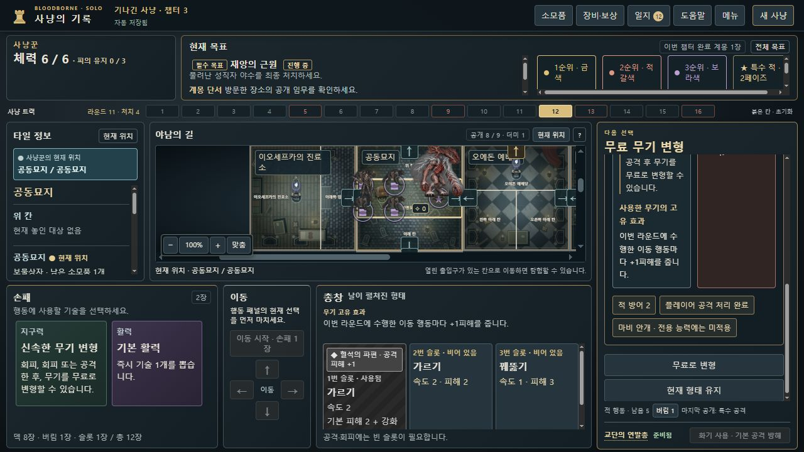

# 마비 안개·전용 능력의 전투 안내 수정 · 0.8.13-dev.20

**확인된 결함은 표시의 적용 범위입니다.** 마비 안개를 사용하면 전용 능력에도 ‘적 공격의 모든 부가 효과 제거됨’과 ‘원래 행동 설명 · 현재 공격의 부가 효과 제거됨’을 표시했습니다. 공격만을 대상으로 하는 효과와 전용 능력을 구분하지 못했습니다. 엔진의 회복 처리·소모품 소진·저장 판정은 변경하지 않았습니다.

## 실제 재현 예시

dev.17 정상 캠페인 완료 저장에서 `state.commands[417]`(0 기준, 418번째 명령)을 재생했습니다. 3장 라운드11, HP8 성직자 야수2페이즈에 리게인·사냥 문자·마비 안개로 공격하면 속도3·피해5가 됩니다. 보스는 전용 능력 ‘회복’을 공개하고 방어2·계몽 제거·현재 덱 섞기를 처리합니다. 실제 피해는3, 보스 HP는8→5입니다.

이때 계몽은0→0입니다. 양수 토큰 제거를 실제 이력에서 관찰했다고 세지 않습니다. 리게인은 치유2를 지시하지만 사냥꾼의 실제 HP는 상한6 때문에5→6입니다. 마비 안개는 소진되고 사냥 문자는 준비 해제되며, 후속 무료 무기 변형 선택이 이어집니다.

## 최종 표시

- 공개된 **공격**: 기존 ‘적 공격의 모든 부가 효과 제거됨’과 원래 효과 설명 표제를 유지합니다.
- 공개된 **전용 능력**: 제거 안내를 붙이지 않고 `마비 안개 · 전용 능력에는 미적용`을 표시합니다. 원문 능력 설명도 정상 표시합니다.
- 능력 설명에 효과가 적혀 있는데도 별도 키워드가 없다는 이유로 붙이던 `추가 효과 없음`은 표시하지 않습니다.
- 실제 적 방어가 있으면 `적 방어 2`처럼 짧게 표시합니다. 피해5가 그대로 들어간다는 인상을 줄입니다.
- 아직 공개하지 않은 행동과 별도 추가 타격에는 현재 공격의 제거 표시를 잘못 붙이지 않습니다.

공식 규칙서20쪽·FAQ3쪽의 공격/전용 능력 구분에 카드의 ‘적의 공격’ 문구를 적용한 해석입니다. **마비 안개와 회복을 직접 조합한 공식 FAQ 답변을 확인한 것은 아닙니다.** 정확한 원문·근거와 확인 한계는 [규칙 자료](rule-sources.md)에 기록합니다.

## 후속 사용자 채택 · 2026-10-16

사용자가 BGG 답변의 해석을 채택했습니다. **능력 자체는 유지 → 같은 전투에서 추가 공개된 공격의 효과 제거 → 속도·피해 증가분 유지**입니다. 능력이 후속 공격에 붙인 독·방해는 제거하지만, 능력 자체의 직접 피해·기절은 유지합니다. 소모는1번이며 다른 전투까지 지속하지 않습니다.

이는 기존 엔진 동작을 확정한 `user-adjudicated` 재정이며 제작사의 공식 판정은 아닙니다. [결정 기록](../../decisions.md), [실제 커뮤니티 답변·반론](rule-sources.md#후속-커뮤니티-조사와-사용자-채택--2026-10-16)에 구분했습니다. 제품 코드·규칙 버전·저장 이력은 바꾸지 않았습니다. 추가 연쇄 회귀 결과는 별도 기록하여 아래 기존139개 검사와 합산하지 않습니다.

## 증거와 검증 범위

원본 `bloodborne-dev17-rifle-campaign-completed-save.json`은68,051바이트, SHA-256 `0c655a1a0698c997f66398e794c392fff65bcf6a66316c4ebee686637b2d57d6`입니다. 전달된 로컬 QA 증거의 크기·해시와 엄격한 불러오기를 확인했습니다. 원본은 보존했습니다. 이는 부모의 정상 UI 완주에서 얻은 **완료 후 저장의 재생**이며, 로컬에서 새 정상 캠페인을 완주한 결과가 아닙니다. 당시 화면은 전달받지 않았으므로 기존 UI는 소스와 동일 상태의 표시 함수로 확인합니다.

[원본·재생 대조](replay-verification.json)는 전체448명령과 공격 전후의 정확한 순번·피해·비용·후속 선택을 기록합니다. [공격 전 저장](ACTUAL-REPLAY-before-command-417.json)은417명령, [공격 후 저장](ACTUAL-REPLAY-after-command-417.json)은418명령의 canonical export입니다. 원본을 수정한 파일이나 새 플레이 기록이 아닙니다.

[관련 회귀139개 통과](focused-tests.json). 신규 [회귀3개](../../../tests/mist-recovery-ui-v0820.test.cjs)는 실제 명령의 피해·소진·치유·엄격한 저장, 실제 UI의 능력 표시·무료 변형, 일반 공격의 안개 제거 유지/실행을 확인합니다. 최종 관련20개 제품·검사 파일의 실행 전후 해시가 동일했습니다. 기존 전체 CI 수치와 합산하지 않으며 이번 수정 후 전체 CI 재실행 결과로 소개하지 않습니다.

[실제 브라우저 기록](native-ui-observations.json): 별도 localhost8818에서 정상 파일 선택기로 해당 상태를 불러오고, 실제 공격 직전 저장에서도 리게인·슬롯·마비 안개·사냥 문자를 직접 고른 뒤 공격을 확정했습니다. 정상 UI로 내보낸 불러오기/공격 결과68,797바이트와 후속 무료 변형 결과65,632바이트는 각각 정확한 공개 명령 결과와 전체 바이트가 일치했습니다. 부착 창에서는 기존 슬롯을 유지하고 닫았습니다. 엔진 직접 호출이나 내부 상태 주입은 하지 않았습니다.

실제 공격·변형의 내보내기는 마지막 `추가 효과 없음` 자리표시자 생략 전 빌드에서 수행했습니다. 최종 빌드를 다시 로드하여 정확한 공격 후 저장을 재불러오고 최종 표시도 확인했습니다. 두 빌드 사이 판정·명령 코드는 바꾸지 않았습니다. 당시 dev.17 스크린샷을 복구했다거나 모든 분기를 새 캠페인으로 완주한 것으로 확대하지 않습니다.

[무료 변형 후 플레이어 차례](evidence/after-free-transform.jpg)까지 이어지는 것을 확인했습니다. [이전 후속 접수](../target-selection-v0.8.13-dev.18/follow-up-qa.md)의 미수신·미검증 표기는 당시 상태이며 이번 조사로 대체합니다.

관리: BB-063, [Issue #65](https://github.com/dfrpg98-jpg/bloodborne-solo/issues/65). dev.19의 선택한 적만 지도 정보를 표시하는 동작은 유지했습니다. 별도 수정 브랜치 `fix/mist-ability-feedback-dev20`이며 병합·8786 배포하지 않았습니다.
