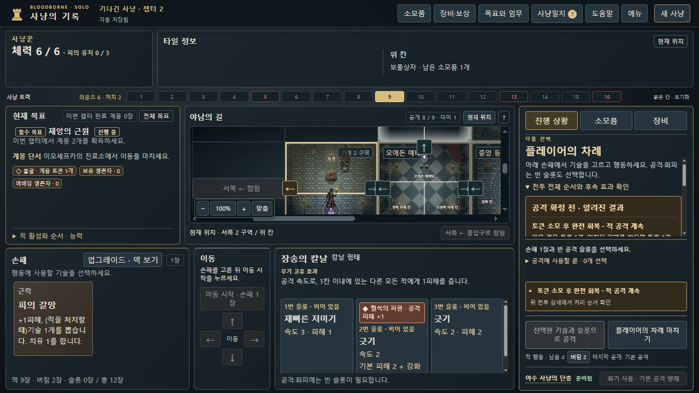
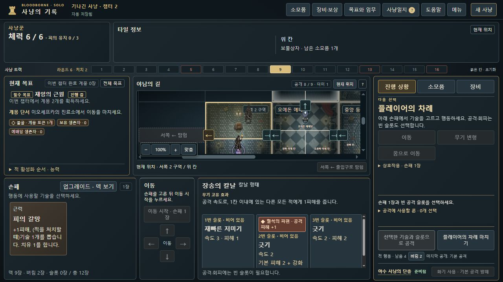
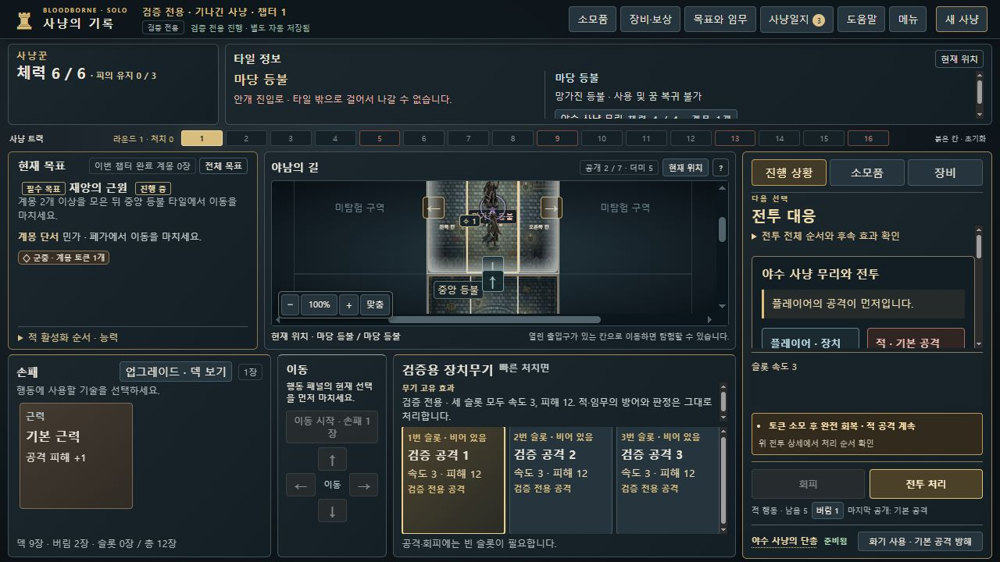

# 선택 문맥 없는 전투 경고 · dev.27 검토 후보

세컨드가 dev.26 정상 캠페인에서 제보한 BB-077을 원본 저장으로 재현하고 표시만 수정했습니다. [Issue #83](https://github.com/dfrpg98-jpg/bloodborne-solo/issues/83). 기준 main은 `771fa4c13b4be162571958315efbc89d10fd73db`이며, 세컨드의 수정본 실제 재검수 전 병합·배포하지 않습니다.

## 재현과 원인

사냥꾼이 사망·꿈 귀환 후 서쪽 2 구역 위 칸에 있습니다. 현재 칸의 적은 0명이고 전투·카드·슬롯 선택도 없지만 ‘토큰 소모 후 완전 회복 · 적 공격 계속’이 나타납니다. 상세는 7칸 떨어진 대교 하인(체력5/5·토큰1)을 가리킵니다. 빈 칸 선택에도 남고 새로고침하면 다시 생깁니다.

렌더의 내부 기본 대상은 같은 칸의 적이 없으면 첫 적을 선택합니다. 기존 예고는 이 값을 명시적 지도 선택·공격 준비와 구분하지 않았습니다. 능력 설명기는 공개된 토큰 경고를 먼저 생성하므로 진행 중 전투가 없어도 이 표시가 나왔습니다. 과거 전투가 저장에 남아 발생한 문제는 아닙니다.

`hunt-app.js`의 예고 연결만 바꿉니다. 사냥꾼 차례에는 직접 살펴보는 적 또는 현재 실행 가능한 공격의 대상만 연결합니다. 현재 렌더가 만든 공격 버튼을 행동 고정 영역으로 옮기기 전에 확인하므로 이전 버튼을 읽지 않습니다. 전투 중에는 기존 전투 대상 경로를 유지합니다. 기본 대상 기능, 순수 예고 계산기, 규칙 엔진, 명령·저장 형식은 그대로입니다. 긴 안내문을 추가하지 않았습니다.

## 정상 원본과 실제 브라우저

- 출처: 실제 dot 세컨드의 정상 플레이를 전달하는 중계 `01a141e3-d341-70c1-aac6-582a06ec9027`. 개발 내부 하위 에이전트를 세컨드로 세지 않습니다.
- 원본 묶음: `bloodborne-dev26-target-context-repro-no-screenshots.zip`, 13,939바이트, SHA-256 `f836a50b3e10839706fb660471f5da5e329518e1752ad556fbb7e2121ab27571`. Library ID `libfile_cbc3297551708191836a59d6febba45e`.
- 보존 원본 두 파일: `dev26-normal-stale-combat-candidate-save.json`, `dev26-normal-after-target-clear-save.json`. 각각 44,891바이트, 동일 SHA-256 `a82cdb9fe6a162882426596fd7284ea09e7c2bbcddf19064ebc8fe65106a50c6`. 원본·동봉 README를 수정하지 않았습니다. 개인 저장은 Git에 복제하지 않습니다.
- 엄격 불러오기→내보내기 바이트 일치. 일반 모드, 명령166개, 라운드6·트랙9·체력6, `phase=hunter`, `combat=null`, 위치 `tile-06:top`, 현재 칸 적0. 내부 첫 적은 `tile-18:top`의 `huntsmans-minion-1`입니다.
- 세컨드의 원본 README는 뒤에 추가된 직접 불러오기 확인보다 먼저 작성됐습니다. 뒤의 별도 수신 보고에서는 같은 원본을 8773에서 직접 불러온 첫 화면에도 경고가 나타나며 재내보내기 바이트가 같았다고 확인했습니다. 이 후속 보고를 기존 README에 소급해 쓴 것으로 취급하지 않습니다.

개발 담당자는 원본의 복사본을 격리된 실제 브라우저 `http://127.0.0.1:8831`의 공개 불러오기 기능으로 열었습니다. 브라우저 상태 주입 없이 수정 전 경고를 확인했습니다. 수정 후에는 다음을 확인했습니다.

| 조작 | 결과 |
|---|---|
| 원본 첫 불러오기·새로고침 | 경고 숨김, 카드·슬롯 미선택 |
| 대교 하인 직접 선택 | 해당 적의 공개 토큰 경고 표시 |
| 대상 선택 닫기·빈 현재 칸 선택 | 경고 숨김 |
| 먼 적을 공격할 수 없는 카드·슬롯 조합 | 경고 숨김 |
| 선택만 바꾼 뒤 내보내기 | 원본과 44,891바이트·해시 동일 |
| 새로고침 뒤 다시 내보내기 | 원본과 44,891바이트·해시 동일 |
| 원본 다시 불러오기 | 경고 숨김, 메뉴 닫힘 |

## 별도 QA와 회귀 범위

정상 사망·귀환 원본과 별개로, 검증 모드의 생성→이동→탐험→배치→이동 종료→꿈→귀환 공개 명령으로 재현 상태를 만들었습니다. 이 QA 경로는 사망 귀환 검사로 세지 않습니다. 상태 수동 편집은 없습니다.

신규 UI 회귀 6개는 빈 칸 귀환·저장 재불러오기, 직접 열람 후 닫기/빈 칸, 같은 칸 공격 준비 후 선택 해제, 실행 불가능한 원거리 공격, 현재 전투, 합법적인 끌어오기 준비를 다룹니다. 관련39개에 신규6개가 포함되며 서로 합산하지 않습니다. 수정 전 최초5개 중4개가 실패했고, 끌어오기 1개는 수정 후 추가했습니다.

실제 브라우저에서는 별도 QA 저장을 공개 불러오기한 뒤 적을 따로 누르지 않고 손패·슬롯을 골랐습니다. 같은 칸 공격 준비에서 경고 표시, 슬롯 해제에서 숨김, 다시 공격하여 전투 대응 단계에서 경고 유지를 확인했습니다. 이 화면은 정상 사망 원본 화면과 구분합니다. 브라우저 오류 로그는 없었습니다.

최종 전체 CI는 149개 파일·3,132개 통과·실패0개, 458.602초입니다. 검사 명령·최종 수치·화면 해시는 [verification.json](verification.json)에 기록합니다. 전체 CI의 기존 참고사진4개 제외 정책은 유지합니다. 정상 캠페인 신규 완주나 스프라이트 전프레임 검토는 수행하지 않았습니다. 신규6개는 도약 경고, 삭제된 적의 `combat_extra` UI, `combat_choose`·`boss_react` 각각을 직접 추가 검사하지 않습니다. 해당 기존 경로의 소스 보존을 개발 내부 리뷰와 세컨드 중계의 독립 읽기 전용 리뷰에서 확인했으며, 수정본 실제 플레이의 세컨드 승인과 구분합니다.

## 로컬 보존

개발 담당자의 입력 복사본·선택 후 및 새로고침 후 내보내기·QA 저장·실행 로그는 Git 제외 경로 `test-results/outcome-context-dev27/`에 모았습니다. 전달된 정상 원본은 중계 작업의 `qa-evidence/dev26-target-context-20261016/originals/`에 유지합니다. 폴더 밖에 추가 ZIP·저장 백업을 만들지 않았습니다.

## 세컨드 PC 후속 검수와 BB-078

세컨드가 고정 커밋 `3405ecb56c80d941eec9551a8e6b557d4a50d348`의 별도 PC UI에서 BB-077의 원본 문맥, 가능한 공격·실제 전투 경고와 정상 플레이22명령을 독립 확인했습니다. [결과·해시·범위](https://github.com/dfrpg98-jpg/bloodborne-solo/pull/84#issuecomment-6227294471). 신규 정상 진척과 별도 historical 재생은 구분하며 새 캠페인 완주로 세지 않습니다.

이어 정상 저장에4명령을 더한 결과는 챕터2 사냥 트랙 만료로 종료됐습니다. 사망이나 다음 챕터 전환으로 처리하지 않습니다. 별도 공개 검증용 도끼 사냥의9명령 저장에서는 적 처치 후 추가 타격 제목이 ‘처치된 적와 전투’인 BB-078을 발견했습니다. 제목만 ‘전투 · 대상 이름’으로 바꿔 처치된 적과 번호가 붙은 적 모두 일관되게 표시합니다.

개발 담당자가 같은 SYNTHETIC-QA 저장의 실제 컨트롤러 DOM에서 전후 제목·추가 타격 표시·저장 불변을 확인했고 기존 관련54개 검사가 통과했습니다. 전투 표시 모듈은 제목 이외의 바이트가 기준 커밋과 같으며 엔진·저장 형식은 그대로입니다. 새로운 문구만 검사하는 테스트나 전체 CI 재실행은 추가하지 않았습니다. 위3,132개 전체 결과는 `3405ecb` 기준이며 이 문구 후속 변경의54개 결과와 합산하지 않습니다. 원본·정상 후속 저장·실행 수치·수정 모듈 해시는 [wording-follow-up.json](wording-follow-up.json)에 기록합니다. 수정된 제목의 세컨드 실제 PC 재확인은 아직 수신 전입니다.
