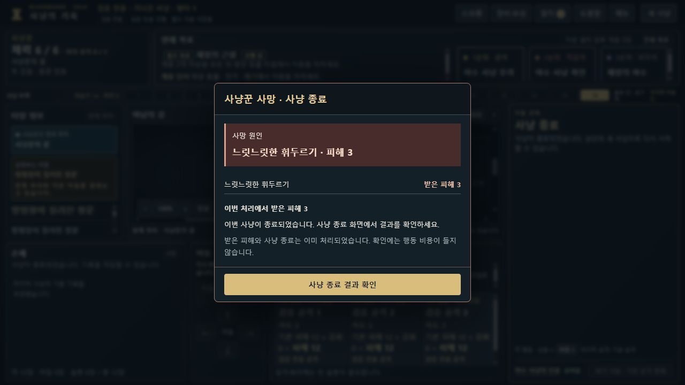
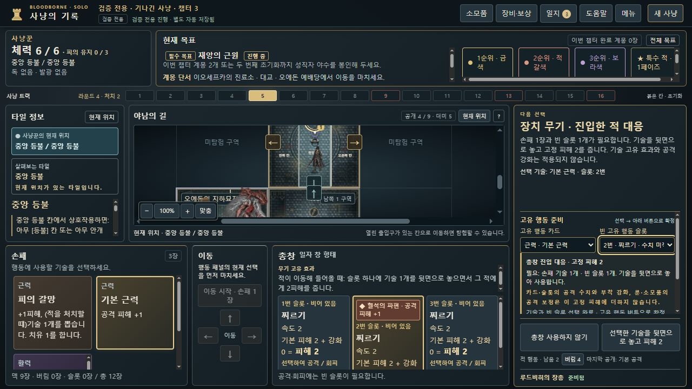
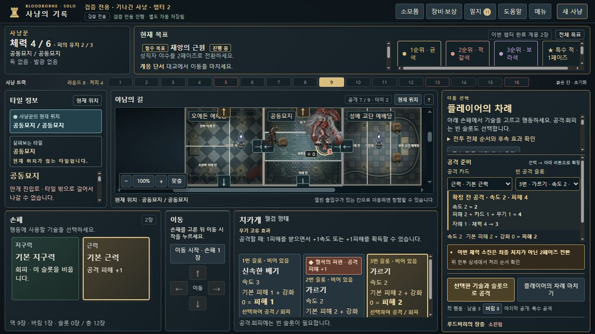

# dev.15 일반 플레이 피드백의 UI 수정

기준은 dev.14 커밋 2b02a42입니다. 클라우드 QA가 전달한 실제 일반 플레이 관찰을 로컬 코드와 대조했습니다. 클라우드의 원본 스크린샷·개인 저장은 이 PC에 있다고 가정하지 않았고 이 기록에 복사하지 않았습니다. 아래 로컬 검증은 별도 검증용 사냥과 명시한 구성 단위 상태를 구분합니다. 게임 판정·저장 명령·임무 트리거를 바꾸지 않습니다. **머지·릴리스·8786 배포를 수행하지 않습니다.**

## 확인한 문제와 재현 예시

| ID | 재현 예시 | 수정 |
|---|---|---|
| BB-052 | 마지막 라운드 HP1에서 하인의 3피해로 사망하면 이미 사냥 종료인데 모달 버튼은 꿈에서 계속이라고 안내했습니다. | 공개된 최종 phase를 반영해 종료 결과 확인으로 표시합니다. HP가 남은 시간 종료에는 사망 창을 만들지 않습니다. 일반 사망의 꿈 복귀는 유지합니다. |
| BB-053 | 원래 명칭이 없는 3칸/2칸 지도에서 미리보기 제목이 비고 현재 위치가 칸 이름만 나와 서로 구별하기 어려웠습니다. | 인쇄된 지명을 새로 만들지 않고 중앙 등불 기준의 ‘북쪽 1 구역’ 같은 지도 주소를 제목·선택 버튼·현재 위치에 공통 표시합니다. 실제 이름 있는 타일은 원래 이름을 유지합니다. |
| BB-054 | 총창의 ‘선택한 카드를 뒷면으로 놓고’가 정리 과정에서 ‘선택한 임무를 으로 놓고’가 됐고, 고정2피해 선택에 근력+1이 적용처럼 보였습니다. | 행동 비용인 뒷면 용어를 보존하고 기술 문맥을 사용합니다. 빈 슬롯/손패 비용과 효과 미적용을 확정 전 표시합니다. 레이테르팔라슈의 일반 공격과 별도 고정 사격은 분리합니다. |
| BB-055 | 도끼 처치 효과의 하인#1·하인#2가 모두 체력5일 때 두 버튼은 같은 적 이름·피해2만 보였습니다. | 대상 번호·지도 위치·현재 체력을 표시하고 고정 행동 영역에서 선택합니다. 선택지 개수도 안내합니다. 예상 잔여HP는 피해 면역/추가 생명 판정을 거치기 전 확정하지 않습니다. |
| BB-056 | 충전 토니트루스 강공격을 고를 때 슬롯의 1속도3피해만 보이지만 실제 선언은 2속도4피해였습니다. 체력2 발톱도 2/2가 실제3/3이 됩니다. | 카드·혈석·보상·소모품·무기 보정을 분해한 선언 속도/피해, 자해 후HP, 충전 소모/만료, 이동 행동 수를 표시합니다. 미공개 적 행동은 읽지 않습니다. |
| BB-057 | 성직자 야수 즉시 능력에 유골로 자동 회피한 뒤 ‘회피 선택됨’이지만 계속 버튼은 피해와 효과를 받는다고 안내했습니다. | 완전 회피가 적용된 대응에서는 회피 적용 후 계속으로 표시합니다. 속도당 부분 방어는 완전 회피로 표시하지 않고 회피 불가 조건은 유지합니다. |

## 검증 경계

- 공격 예고는 기존 weapon-rules의 순수 보정 계산을 재사용하며 가상의 ATTACK을 dispatch하거나 숨은 덱을 읽지 않습니다. 표시된 피해는 공격 선언 성능이며 적의 방어·면역 적용 후 실제 손실HP를 미리 확정한 값이 아닙니다.
- 전체 공급 무기 양면·빈 슬롯·근력/기술/지구력 237개 선언을 비교한 검사는 컴포넌트 단위 검사입니다. 네이티브 브라우저에서 237회 플레이했다고 집계하지 않습니다.
- 도끼의 동일 이름·체력 적 두 명, 일부 무기 효과의 경계값은 명시적으로 구성한 단위 상태입니다. 정상 내보내기 저장이라고 주장하지 않습니다. 카드/슬롯 UI 핸들러 결과는 실제 reducer와 전체 상태를 비교합니다.
- 네이티브 확인은 합법 명령으로 만든 검증용 저장을 8815에서 정상 불러옵니다. 체력·적·손패·덱을 브라우저 스크립트로 수정하지 않습니다. 활성 개인 진행의 8786은 교체하지 않습니다.
- 최종 전체 검사와 실제 화면 결과는 완료 후 별도 결과 파일로 기록합니다. 추가 유골 피드백이 도착해 그 전의 전체 실행은 중단했으며, 그 부분 실행을 통과 결과로 집계하지 않습니다.

## 추가 제안의 관리

다음은 확인된 판정 오류와 분리해 후속 UI 개선 항목으로 남깁니다. 이번 패치에서 임무 조건이나 보상·사망 처리 순서를 변경하지 않습니다.

- 목표 완료 전 현재HP/손패 준비도 안내: 숨은 사건의 내용·트리거를 예고하지 않는 범위에서 검토.
- Blood Frenzy 조건의 ‘이 적의 체력’ 주체 명시와 반복 모달 대신 인라인 배지.
- 보상 선택 후 남은 전투 대응이 있다는 안내. 기존 대응 누락 버그로 분류하지 않음.
- 적이 공격 전에 처치되는 경우와 이미 시작된 추가 타격을 구별하는 위험 예고 개선.
- 대포 선택 화면의 지팡이 문구 사례는 클라우드 증거 필요 시 문맥 재현. 실제 무기 효과 오적용은 미확인.
- 클라우드 전달 범위의 3장·캠페인 승리·모바일·키보드/화면 읽기 도구 미검증 상태는 유지합니다. 이번 UI 수정으로 전체 캠페인 재검증 완료라고 바꾸지 않습니다.

## 실제 브라우저 확인

8815의 검증용 진행에서 마지막 사망, HP6 시간 종료, 3칸 타일 회전·배치, 총창 고정 사격, 토니트루스 충전 선택, 체력2 발톱의 공격 선언, 레이테르팔라슈 고정 사격, 치카게 자해 공격을 확인했습니다. 상세 동작·스크린샷 해시는 [브라우저 기록](browser-verification.json)에 있습니다. 토니트루스의 네이티브 사례는 선택 예고까지이며, 실제 충전 소모는 자동 reducer 대조 검사로 구분합니다. 도끼 동일 대상과 유골 보스 대응은 네이티브 플레이로 집계하지 않습니다.

관리 이슈: [#57](https://github.com/dfrpg98-jpg/bloodborne-solo/issues/57). 검증용 주소는 기존 플레이 주소와 저장 출처가 다릅니다.





## 클라우드 QA에서 같은 검증 입력 만들기

[공개 명령 입력 9건](reproduction-inputs.json)은 개인 저장이 아니라 이 작업에서 생성한 QA 구성과 실제 명령만 포함합니다. 각 입력을 다시 만들고 기존 내보내기와 동일함을 로컬에서 대조했습니다. 예를 들어 저장 불러오기 전 파일을 다음과 같이 만들 수 있습니다.

```js
const fs = require("node:fs"), E = require("./hunt-engine");
const { cases } = require("./docs/audits/playtest-ui-v0.8.13-dev.15/reproduction-inputs.json");
const input = cases.find(item => item.id === "claw-low-hp");
let state = E.create(...input.createArgs);
for (const command of input.commands) state = E.dispatch(state, command);
fs.writeFileSync("dev15-qa-reproduction.json", E.exportSave(state));
```

이후 수정본에서 해당 파일을 정상 불러옵니다. 유골 보스·도끼 동일HP 검사는 구성 단위 상태이므로 이 입력 묶음에 일반 진행 저장으로 넣지 않았습니다.

## 최종 결과

2026-10-16 KST의 로컬 전체 검사 **2928/2928 통과**, 실패·취소·건너뜀0, 소요408.953초입니다. 검사 전후595파일의 해시가 같았습니다. [전체 검사 결과](full-ci-result.json)에 실행 환경·범위를 기록했습니다. 원본 사진에 의존하는4개 검사는 기존 CI 정책에 따라 실행 대상에서 제외하며, 그 검사까지 통과했다고 주장하지 않습니다. 네이티브8건과237개 선언 대조는 전체 검사에 더해 중복 집계하지 않습니다.

검사 준비 중 추가 유골 피드백을 반영하기 위해 한 번 중단했고, 다음 시도의 안내 문구 검사1건은 예전 ‘카드’ 문구를 기대하고 있어 현재 ‘손패1장’ 문구로 맞춘 뒤 집중60건과 최종 전체 검사를 다시 통과했습니다. 단순히 게임 상태 비교 항목을 삭제하지 않았습니다.

게임 판정 파일 hunt-engine/weapon-rules/weapon-flow/임무·보상 reducer의 diff는 없습니다. Desktop의 dev.14 제품341파일도 이전 해시와 모두 같습니다([미배포 확인](desktop-unmodified.json)). GitHub에는 수정 브랜치와 초안 PR만 준비하며, 기존 플레이 폴더에 복사하거나 릴리스·태그·머지하지 않습니다.

## 후속 독립 클라우드 검증 · 문서 반영

위의 도끼 동일HP 대상·유골 보스 대응이 구성 단위 검사라는 설명은 최초 제품 점검 당시의 범위입니다. 이후 [직접 불러오기용 합성 QA 자료](../../qa/dev15-synthetic-ui/README.md)를 제공했고, 별도 클라우드 8767에서 제품 커밋 `179afaefd273e2e386714ed7ec80d217ef1e676e`을 확인한 결과를 전달받았습니다.

- **일반 새 사냥:** 토니트루스 근력·1번 슬롯의 충전 예고 속도3·피해4(기본2+카드1+무기1), 공격 없이 라운드 종료 후 속도2·피해3·충전 없음 표시를 독립 확인했습니다. 실제 공격 실행·완주 검증으로 확대하지 않습니다.
- **합성 도끼:** 번호·위치·HP·피해 표시와 대상2 선택 시 하인2만5→3, 하인1은5 유지하는 것을 독립 확인했습니다. 추가 전달에서 **원본 재불러오기 후 대상1도 선택해 하인1만5→3, 하인2는5 유지를 확인**했으므로 양쪽 선택 모두 독립 클라우드 검증 완료로 갱신합니다. 합성 QA 결과로 구분합니다.
- **합성 유골:** 자동 회피 안내·‘회피 적용 후 계속’, 처리 후 HP6/6·손패2장 유지와 다음 조우 진행을 독립 확인했습니다. 합성 저장의3장을 캠페인 진도로 집계하지 않습니다.
- **기존 일반 총창 저장:** 실제 플레이의1장 완료 저장을 dev.15에 정상 불러와2장 준비 화면을 확인했습니다. 저장 호환·복원 확인이며 새1장 완수나2장 완수로 집계하지 않습니다.

[후속 결과와 한계](../../qa/dev15-synthetic-ui/independent-cloud-ui-verification.json)를 별도로 보존합니다. 기존 로컬 자동2928건·네이티브8건의 수를 변경하거나 일반 플레이 성과에 합산하지 않습니다. 이 반영 작업은 검증 문서만 변경하며 제품 로직·머지·배포는 변경하지 않습니다.
