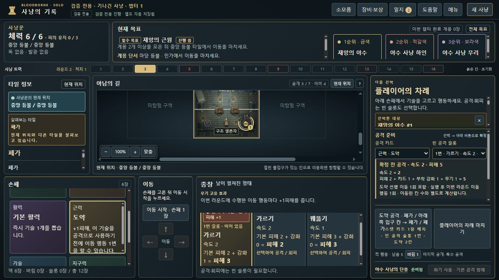

# 총창·도약 이동 행동 누락 · 0.8.13-dev.17

**도약의 선행 이동을 실행했는데 총창의 이동 행동 횟수가 늘지 않는 구현 오류(BB-059)를 확인하고 수정했습니다.** 일반 MOVE만 횟수를 증가시키고 도약은 이동 상태를 직접 생성하는 별도 경로라서 빠졌습니다. 수정 후 선택 예고와 실제 공격 모두 선행 이동을 1회 반영합니다.

관리: [Issue #61 · BB-059](https://github.com/dfrpg98-jpg/bloodborne-solo/issues/61).

## 원문 근거와 판단의 범위

- 제공된 총창 뒷면 원본 `20261011_235321.jpg`와 [전사](../../../components/extended-weapons.json)는 ‘이번 라운드에 수행한 이동 행동마다 +1피해’를 명시합니다. 사진 경로·SHA256은 해당 구성품의 `source`에 보존돼 있습니다.
- [도약 한국어 전사](../../../components/cards.json)는 공격으로 사용하기 전에 이동 행동 1번을 수행할 수 있다고 적습니다. 별도의 한국어 도약 원본 사진은 확보하지 못했으므로 사진을 보았다고 주장하지 않습니다.
- [CMON 공식 FAQ v1.0](https://www.cmon.com/wp-content/uploads/2023/06/Bloodborne_Boardgame_FAQ_v1.0.pdf) **3쪽**의 도약 원본 카드에는 **“May make a Move action”**이라고 적혀 있습니다. 본문은 최대 2칸 밖에서 개시해 적이 있는 칸으로 이동한 뒤 정상적으로 공격하는 절차를 설명합니다. 이번 조사에서 공식 URL을 가져와 기존 로컬 PDF와 같은 5,081,655바이트·SHA256 `56e47d28bfdb0e964374e8fef883dea147534a9a7338ef9fd63e2b9084c45b4b`임을 확인했습니다.
- 제공된 한국어 규칙서 **14쪽**은 한 이동 행동으로 최대 2칸 이동한다고 구분합니다. 도약으로 1칸을 이동하든 2칸을 이동하든 **이동 행동 1회**입니다.

총창과 도약의 조합을 직접 다룬 별도의 공식 FAQ 답변을 찾았다고 주장하지 않습니다. 결론은 위 두 카드가 명시한 ‘이동 행동’ 문구와 이동 절차를 결합한 판단입니다. 일반적인 강제 이동이나 회피 이동을 모두 이동 행동으로 바꾼 재정이 아닙니다.

## 실제 플레이에서 전달받은 관찰

부모 클라우드가 수행한 **dev.16 일반 총창 플레이** 관찰입니다. 아래 원본 파일들은 부모 클라우드에 있으며 로컬에서 열거나 재생한 것처럼 집계하지 않습니다.

| 보고된 조건 | dev.16 관찰 | 원문에 따른 기대 |
|---|---|---|
| 펼친 형태·1번 가르기 기본2+혈석1·도약 card-14 +1. 라운드7 대교 아래 칸→대교 칸. 같은 라운드 일반 MOVE 없음 | 공격 피해4, 도약 이동 보너스 없음 | `2+혈석1+도약1+이동1=5` |
| 일반 MOVE 1회 뒤 공동묘지 아래 칸에서 도약 card-14·1번 혈석 슬롯 공격 | 이동 행동1회·예고 피해5. 공격 뒤에도 횟수1, 보스HP10→7(방어2) | 이동 행동2회·선언 피해6. 같은 방어2이면 피해4 |

관련 파일: `dev16-rifle-leap-attack-comparison.jpg`, `bloodborne-dev16-rifle-after-leap-observation-save.json`(전투 후 사망·꿈 귀환 대기의 로그 기록용), `bloodborne-dev16-rifle-before-leap-save.json`(일반 MOVE 후 도약 직전), `dev16-rifle-after-leap-still-one-move.jpg`. 이 실측은 누락 현상을 확인한 보고이고, 규칙상 가산 여부의 판단과 구분합니다.

## 변경한 계산과 저장 호환

- `hunt-engine.js`: 유효한 도약 경로와 비용을 검사한 뒤 실제 선행 이동을 개시할 때 횟수를 **한 번** 증가시킵니다. 추격·진입 반응·임무/보상 뒤 공격을 재개하는 경로에서 다시 증가시키지 않습니다.
- `hunt-attack-preview.js`: 현재 타깃에 대한 타 칸 도약 이동이 실행될 선택이면 예상 횟수1을 더한 뒤 기존 무기 보정 계산을 사용합니다. ‘도약 선행 이동 1회 포함’과 실행 후 라운드 횟수를 표시합니다. 가상 ATTACK을 실행하거나 비공개 덱을 읽지 않습니다.
- `hunt-app.js`: 예고에 선택한 적을 전달하고, 신규 총창 시작/불러오기/행동 후 안전 시점에 아래 보정 정책을 채택합니다. 같은 칸에서 이동 없이 공격, 맞서 공격, 카드 효과를 대체한 손톱자국에는 선행 이동을 더하지 않습니다. 첫 형태에서도 실제 도약 횟수는 추적하지만 추가 피해는 펼친 형태의 고유 효과에서만 적용합니다.
- 변경된 엔진·예고·앱의 실제 SHA256을 HTML의 dev.17 캐시 구분에 반영했습니다.

**과거 저장은 원래 규칙으로 먼저 정확히 재생합니다.** raw `E.create`의 기존 규칙14 의미를 조용히 바꾸지 않습니다. `E.applyLeapMoveRuling()`이 총창(양면·규칙10~14)의 안전한 시점에 `APPLY_LEAP_MOVE_RULING` 명령과 `leapMoveRuling:"move-action"`을 별도 기록합니다. 이 명령은 비용·체력·난수·임무·기존 카운터를 바꾸지 않으며, 이후 실행하는 도약부터 수정한 처리를 적용합니다. 과거 공격이나 과거 도약 횟수를 소급 보정하지 않습니다.

이미 선언한 전투, 도약 이동, 추격/무기 후속 처리, 상호작용, 임무 도착 반응 중에는 채택을 미룹니다. 기존 피해4 공격을 불러오면 그 선언과 저장 바이트를 그대로 보존하고 안전한 다음 시점부터 수정 규칙을 적용합니다. 저장 포맷 버전과 규칙 버전 태그를 임의 변경하지 않습니다. 다른 무기의 일반 이동/처치 이동은 이번 정책의 자동 채택 대상이 아닙니다.

기존 UI 하네스·명령 재생 도우미는 과거 경계 검사에 새 정책을 자동 삽입하지 않도록 기존 정책과 같은 격리 방식을 유지합니다. 신규 UI 검사에서는 실제 엔진의 채택 함수와 엄격한 저장 가져오기를 사용합니다.

## 재현과 검증 범위

신규 [핵심 검사](../../../tests/rifle-leap-move-v0817.test.cjs) **17개**, [UI 검사](../../../tests/rifle-leap-ui-v0817.test.cjs) **3개**가 통과했습니다. 다음을 포함합니다.

- 도약1·2칸이 각각 이동 행동1회, 일반 MOVE와 합산, 첫 슬롯2+혈석1+도약1+이동1=5.
- 같은 칸·맞서 공격·룬 대체 제외, 잘못된 경로의 원자성, 다음 공격까지 횟수 유지와 다음 라운드 초기화.
- 정책 명령의 순수성·중복 채택 거부·규칙10~14·양면과 타 무기 경계.
- 수정 전 정책의 입력/공격 결과 해시 고정·엄격한 재불러오기, 이미 진행 중인 공격 보존과 안전한 지연 채택.
- 실제 카드/슬롯/대상 선택 핸들러의 예고와 확정 결과 일치, 선택만으로 비용/저장을 바꾸지 않는 조건.
- 공개된 대상·경로만 읽고 비공개 덱이나 가상 dispatch를 사용하지 않는 예고.

최종 로컬 전체 회귀 검사 **2,980/2,980 통과**, 실패·취소·생략0개, 소요403.781초입니다. [실행 결과](full-ci-result.json)에 명령·범위를, [검사한600파일 해시](full-ci-source-hashes.json)에 실제 작업 트리를 보존합니다. 전후 해시가 모두 같았으며, 원본 사진을 필요로 하는4개 검사는 기존 CI 정책에 따라 실행 대상에서 제외했습니다. 그 사진 검사나 원격 GitHub CI까지 통과한 것으로 주장하지 않습니다. 신규20개와 아래 실제 브라우저 관찰은 전체 수에 다시 더하지 않습니다.

## 실제 로컬 브라우저

별도 읽기 전용 **8817**에서 정상 파일 선택기·제품 컨트롤로 수행했습니다. [합성 QA 입력](SYNTHETIC-QA-before-rifle-leap.json)은 seed1·총창 펼친 형태·챕터1 라운드2의 별도 재현입니다. QA 지급 도구와 정상 공격으로 준비 전투를 처리하고 실제 꿈 시장에서 도약을 구입한 공개 명령만 사용했습니다. 첫 슬롯 혈석을 장착했고, 브라우저 내부 상태 주입·직접 저장 편집은 사용하지 않았습니다. 부모의 라운드7 대교/공동묘지 진행을 그대로 재생한 결과나 새 일반 캠페인 완주가 아닙니다.

1. 도약·첫 혈석 슬롯·폐가의 실제 적을 선택하면 예고는 `2+카드1+부착1+무기1=5`, 도약 이동1회 포함을 표시합니다.
2. 2칸 도약을 실제 확정하면 폐가로 이동하고 전투 비교에 **피해5**가 표시됩니다. 내보낸 전체 상태는 정책 채택 후 해당 ATTACK 명령의 엔진 결과와 정확히 같습니다.
3. 전투를 처리해 플레이어 차례·HP4로 복귀했습니다. 일반 이동 시작 → 아래쪽 입구 칸 선택 → ‘이 칸으로 이동’ 확정 → 이동 종료를 수행했습니다. 최종 위치는 `tile-03:entry`, 횟수2이며 전체 저장이 `ATTACK → RESOLVE → MOVE → STEP → STOP_MOVE`의 결과와 같습니다.
4. [이미 선언한 과거 피해4 공격](SYNTHETIC-QA-legacy-attack-in-progress.json)을 정상 불러옵니다. 전투 비교는 계속 피해4이고 정책 채택이 보류됐으며, 다시 내보낸 파일은 입력과 모든 바이트가 같습니다.

[네이티브 내보내기 결과·해시](native-verification.json)와 [대조 스크립트](verify-native-exports.cjs)에 3개 실제 내보내기를 연결합니다. 입력은 [공개 명령 재현 도우미](../../../tests/helpers/rifle-leap-checkpoints.cjs)에서 다시 만들 수 있고, `node docs/audits/rifle-leap-v0.8.13-dev.17/verify-native-exports.cjs`가 입력 바이트와 내보내기·전체 상태를 대조합니다. 공식 FAQ 원본과 부모 클라우드 파일을 이 묶음에 복사하지 않았습니다.

[실제 전투 비교 피해5](evidence/leap-first-shard-comparison.jpg), [전투 후 다음 차례](evidence/leap-resolved-next-turn.jpg), [이어지는 한 칸 이동](evidence/leap-followup-move.jpg), [과거 선언 피해4 보존](evidence/legacy-declaration-preserved.jpg).

수정본은 `fix/rifle-leap-move-dev17` 브랜치입니다. 사용자 Desktop 배포본·기존 플레이 주소·개인 저장 파일은 바꾸지 않았습니다. 병합·배포·정식 릴리스 완료를 의미하지 않습니다.
