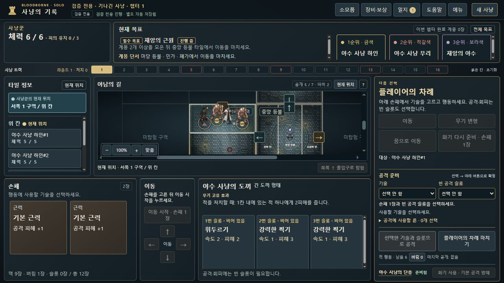
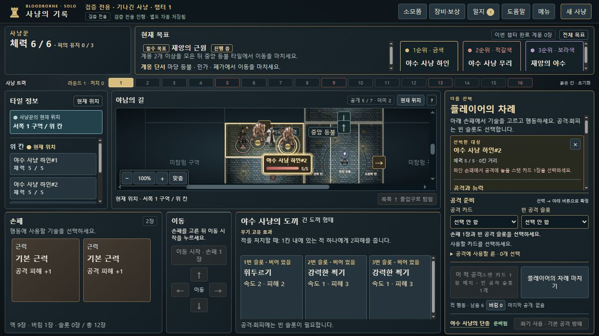

# 선택한 적의 지도 정보만 표시 · 0.8.13-dev.19

dev.18은 적을 고르지 않아도 지도 위 모든 적의 이름·체력 카드를 표시했습니다. 사용자 피드백에 따라 **기본은 숨김, 선택한 살아 있는 적 하나만 표시**하도록 수정했습니다. 기존 타일 정보 패널의 목록과 마우스 툴팁은 별도이며 이름·체력 카드의 상시 표시는 제거했습니다.

## 동작

- 초기 화면·새로고침·불러오기에는 지도 정보 카드가 없습니다. 공격용 내부 기본 대상이 있어도 선택 강조나 정보 카드를 만들지 않습니다.
- 지도·적 목록·행동 대상 선택에서 고른 적 하나만 이름·체력바·공개 계몽 정보를 표시합니다. 다른 적을 고르면 기존 카드는 없어집니다.
- 다른 칸·출입구·타일 정보·현재 타일을 고르거나 대상 선택의 ×를 누르면 숨깁니다. 행동 실행·처치 뒤 자동 대체 대상에도 표시하지 않습니다.
- 소모품·보상 선택창의 현재 대상 미리보기와 선택 보존은 유지합니다. 단순 메뉴 개폐는 선택을 취소하지 않습니다. 판정·비용·저장 형식은 바꾸지 않았습니다.

## 검증

[관련 회귀 110개 통과](focused-tests.json). 대상 선택 검사24개에는 기본/불러오기 숨김, 선택한 적 하나만 표시, 해제5경로, 처치 후 기본 대상 비표시, HP·토큰 값과 저장 불변 검사가 포함됩니다. 해당 제품·검사 파일은 실행 전후 해시가 동일했습니다. dev.18의 전체 CI3,028개와 구별하며 이번 수정 후 전체 CI를 다시 실행한 수치는 아닙니다.

별도 localhost8818에서 기존 합성 QA를 정상 파일 선택기로 불러와 실제 지도 선택·해제·대상 전환·타일 정보·새로고침·보상 선택을 확인했습니다. [실제 관찰7건](native-observations.json)의 표시 개수는 `0→1→0→1→0→0→1`입니다. 이후 정상 UI로 [내보낸 저장](evidence/selection-only-export.json)은 입력과 **15,040바이트 전체 동일**했습니다. 내부 상태 주입이나 브라우저의 엔진 직접 호출은 사용하지 않았습니다. 사용자8786 플레이본 배포나 일반 캠페인 완주 결과가 아닙니다.

선택 전:

선택 후:

관리: BB-062, [Issue #63](https://github.com/dfrpg98-jpg/bloodborne-solo/issues/63), [검토용 PR #64](https://github.com/dfrpg98-jpg/bloodborne-solo/pull/64). 전체 적의 상시 카드를 보여 주는 dev.18 캡처는 이번 표시 조건의 근거로 사용하지 않습니다.
