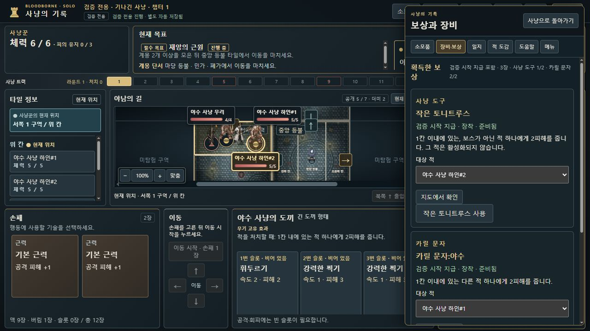

# 적 대상 선택·지도 연결과 화면 정보 정리 · 0.8.13-dev.18

같은 칸의 동명 적을 구별하기 어렵고(BB-060), 보상 대상 선택이 UI 재렌더 중 바뀌던 문제(BB-061)를 수정했습니다. 긴 위치·체력 문장을 선택지마다 붙이는 대신, **짧은 이름을 고르면 해당 적이 지도에서 즉시 강조되고 체력·계몽 토큰을 확인하는 방식**으로 정리했습니다.

관리: [Issue #63 · BB-060–061](https://github.com/dfrpg98-jpg/bloodborne-solo/issues/63). `fix/rifle-leap-move-dev17` 위의 `fix/target-selection-clarity-dev18` 개발본입니다. 병합·Desktop 복사·8786 배포 기록이 아닙니다.

## 확인된 결함과 최종 동작

| 재현 예시 | 최종 동작 |
| --- | --- |
| 같은 칸의 체력5 하인 둘을 고르면 두 선택지가 같은 이름 | 하나뿐이면 `야수 사냥 하인`, 같은 이름이 여럿이면 `야수 사냥 하인#1`, `#2`. 지도·선택지·대상 정보가 같은 표시명을 사용 |
| 작은 토니트루스 #2를 고르고 사냥 문자 사용을 체크하면 대상이 #1로 초기화 | 유효한 대상·목적지를 UI 메모리에 유지. 실제 실행은 고른 적의 ID로 한 번 처리 |
| 소모품·보상 창이 지도를 가려 어느 적인지 확인하기 어려움 | 적 선택지가 있는 창만 우측 드로어, 좁은 화면은 하단 시트. 선택 즉시 지도를 맞추고 적을 강조하며 선택 컨트롤의 초점은 유지 |
| 도끼 추가 피해나 총창·횃불 진입 반응에서 지도 선택과 실제 대상이 혼동됨 | 확정·지도 확인 쌍을 함께 배치. 고정 진입 반응은 실제 진입한 적을 표시하며 지도를 살펴봐도 실행 대상을 바꾸지 않음 |

번호는 **현재 지도에 있는 동명 적의 배열 등장 순서**입니다. 재사용되는 물리 피규어 번호와 다르며 저장된 `enemyId`는 바꾸지 않습니다. 물리 피규어4가 혼자 있으면 이름만, 현재 목록에 피규어3·1 순으로 동명 적이 있으면 표시명은 #1·#2입니다. 제거·재출현 후 현재 목록에 따라 번호가 달라질 수 있습니다. 실행·저장·재생에는 원래 ID를 사용합니다.

## 선택·지도 표시·선택 보존

- 보상·소모품에서 적을 고르면 창을 닫지 않고 지도에 즉시 반영합니다. 같은 창을 다시 열면 최근의 유효 대상을 미리 보여 줍니다. **지도에서 확인**은 창을 닫고 마커에 초점을 보내는 보조 동작이며 필수 단계가 아닙니다.
- 선택지에서 긴 주소·HP와 시각적으로 중복되는 선택 요약을 제거했습니다. 접근성용 상태 알림은 유지합니다. 실제 비용·사용 가능 여부·효과·손실 확인·확정 버튼은 숨기지 않습니다.
- 지도 상태 카드는 이름·현재/최대 HP·실제 HP 비율 막대·공개된 계몽 토큰을 표시합니다. **확인된 0개도 0으로 표시**하며 알려지지 않은 수를 0으로 추정하지 않습니다. 스프라이트 캔버스 위의 별도 레이어에서 겹침을 줄여 배치하고 연결선을 표시합니다.
- 이동 중 카드 위치는 Phaser의 실제 보간 좌표를 따라갑니다. 선택한 적만 1.6초 주기로 불투명도 **72–100%** 사이에서 완만하게 강조합니다. 모션 감소 설정에서는 정적인 강조를 사용합니다. 선택 변경·해제·죽음에서 강조를 정리하며 이동·피격·사망 애니메이션을 재시작하거나 좌우 반전시키지 않습니다.
- 보상별 대상·적별 목적지, 소모품별 대상·목적지를 재렌더·창 재개에서 보존합니다. 소모품의 유효하지 않은 대상·목적지는 변경 사실을 알립니다. 실제 행동 성공·새 사냥·저장 불러오기에서는 UI 캐시를 비우며 게임 저장 형식에 임시 선택을 추가하지 않습니다.
- 적격·범위·보스 제한·안개 경로·피해·추격·보상 소진·명령 ID는 기존 엔진 판정을 사용합니다. 전체 대상 효과를 단일 대상 효과로 바꾸지 않았습니다.

구현 근거: [앱](../../../hunt-app.js), [소모품 선택](../../../inventory.js), [창 전환](../../../hunt-shell.js), [이동·선택 표현](../../../hunt-presentation.js), [스타일](../../../hunt.css).

## 화면 전반의 정보 정리

[화면별 검토](screen-review.md)는 소스·DOM 검사와 실제 화면의 범위를 구분합니다.

| 영역 | 정리한 내용 | 유지한 판단 정보 |
| --- | --- | --- |
| 사냥꾼 | 독·발광 ‘없음’ 문장 제거. 실제 상태 이상만 칩 표시 | 체력·피의 유지·현재 위치·발생한 상태 이상 |
| 무기·행동 | 강화0 슬롯은 속도·피해만 표시. 각 슬롯의 공격/회피 반복 안내를 패널 한 줄로 모음. 중복 선택 요약은 시각적으로 숨김 | 실제 강화가 있으면 기본+강화 수식, 사용된 슬롯 구분, 빈 슬롯 조건, 확정 컨트롤 |
| 타일 정보 | 같은 현재·열람 위치의 반복 설명 정리 | 다른 타일을 살펴보는 경우의 구분, 타일 능력·상호작용·적 정보 |
| 목표·챕터 | 일지의 중복 목표 제목 정리. 단계의 자세한 설명은 현재 단계에 표시 | 필수/계몽 목표, 공개 조건·진척, 보상→마지막 꿈 성장→다음 챕터 |
| 화기·부착·메뉴 | 획득·부착 안내 축약. 지도 기호·시작 위치 규칙·준비 시드는 펼침 항목 | 장착/보관·슬롯 공격/속도·화기 능력·재준비 비용·저장과 불러오기·손실 경고 |
| 도움말 | 일반 플레이 이동·탐험·전투3단계를 먼저, 상세 순서·규칙은 닫힌 펼침 항목 | 카드/빈 슬롯/확정 버튼 순서, 회피 선택 뒤 실행, 비용·예외 |

공개된 **구원 임무**는 남은 토큰 수만 보여 주는 대신 `처치 0/2 → 1/2 → 2/2`의 진행을 표시합니다. 진행 중이면 NPC 칸에서 도보 동행을 선택할 수 있다는 짧은 힌트를 붙입니다. 토큰은 남은 수, 분수는 완료한 적격 처치 수로 구분합니다. 동행을 자동 실행하거나 모든 생존자에게 무료 호위를 적용하지 않습니다. [공개 목표 표현](../../../hunt-public-text.js)의 표시 수정이며 미공개 보상·후속 이야기를 노출하지 않습니다.

## 실행한 검증

서로 다른 검사 묶음이며 전체 CI에 다시 더하거나 네이티브 관찰과 합산하지 않습니다.

| 검사 | 결과 | 범위 |
| --- | --- | --- |
| [대상 선택 UI·엔진](../../../tests/playtest-target-selection-ui-v0818.test.cjs) | 22개 통과 | 짧은 이름·등장 순서 번호·선택 보존·즉시 지도 반영·HP/토큰·고정 진입 대상 |
| [기존 도끼·위치 회귀](../../../tests/playtest-location-target-ui-v0815.test.cjs) | 4개 통과 | 추가 피해의 명시적 대상과 위치 표현 경계 |
| [선택 표현·이동 좌표](../../../tests/target-selection-presentation-v0818.test.cjs) | 8개 통과 | 강조·모션 감소·이동/피격/사망 후속 처리·실제 보간 좌표 |
| [기본 도움말·시작](../../../tests/ui-information-density-v0818.test.cjs) | 3개 통과 | 첫 안내3단계·상세 안내 보존·자동/명시적 시드 정상 시작 |
| [구원 진행 표시](../../../tests/salvation-progress-ui-v0818.test.cjs) | 8개 통과 | 공개 조건·진척·재불러오기·동행 힌트·미공개 정보 차단 |
| [추가 단계 UI 핸들러](../../../tests/ui-phase-contracts-v0818.test.cjs) | 7개 통과 | 피규어 재배치·능력 비용 선택·비열한 일격 사용/생략·예배당 교환 수락/생략 |

마지막7개는 [별도 실행 결과](phase-handler-verification.json)로 확인합니다. 앞의 세 종류는 공급 수량을 맞춘 입력에서 실제 reducer로 단계에 진입한 **구성 단위 검사**이며 일반 캠페인 저장이 아닙니다. 예배당 교환은 현재 규칙14의 공개 명령·엄격한 불러오기를 사용합니다. 대상 선택 묶음도 공개 명령 QA와 고정 진입·표시 경계용 구성 입력을 구분합니다.

**최종 로컬 CI: 3,028/3,028 통과**, 실패·취소·생략0건입니다. 2026-10-16 UTC 실행은409.782초 걸렸고, 실행 전후 보호 대상605개 파일의 SHA-256이 모두 동일했습니다. [최종 결과](full-ci-verification.json), [실행 명령](full-ci-command.json), [시작 해시](full-ci-before-hashes.json), [종료 해시](full-ci-after-hashes.json)에 기록합니다. 신규48개를 포함한 전체 수치이며 개별 검사와 합산하지 않습니다. 기존 CI 정책에서 원본 사진에 의존하는4검사는 제외되며, 그 사진 검사나 원격 GitHub CI를 통과한 것으로 세지 않습니다.

## 단계별 점검과 역사 이력의 한계

[단계 범위 기록](phase-coverage.json)은 기존 규칙11 명령 이력2개·총 **683명령**을 현재 엔진으로 재생한 뒤 대표 상태를 현재 UI에 불러온 결과입니다. 단계별 표본과 후속 챕터 첫 사냥꾼 상태를 포함한 **43개 DOM 표본 모두 통과**, 등록33단계 중22종에 도달했습니다.

네 가지 정책 채택 함수를 항등 함수로 격리하고 버튼을 누르지 않았습니다. 과거 저장의 표현·컨트롤 존재·렌더 중 저장 보존을 보는 검사이며 **현재 정책의 새 완주나 네이티브33단계 플레이 증거가 아닙니다.** 나머지11종은 기존 UI 근거7종과 신규 핸들러4종을 각각 연결했습니다. 별도 단계 조사에서 기존7종은 파일을 읽어 연결했고, 해당 테스트 파일도 위 최종 전체 CI에 포함되어 통과했습니다. 가능한 모든 분기·실제 가시성·포인터 입력까지 보장하지 않습니다.

구원 표시의 로컬8개 검사는 **규칙13 공개 명령 이력**을 사용합니다. 부모가 보고한 dev.17 일반 플레이 구원 관찰과 원본 파일은 클라우드에 있으며, 여기서 열거나 그 진행을 재현했다고 주장하지 않습니다. 부모의 일반 플레이 성과와 로컬 역사 이력·합성 검사를 합산하지 않습니다.

추가로 받은 dev.17 정상 캠페인 완수·NPC 동행 보고와 감각마비 안개/보스 회복 표시의 **미검증 후보**는 [후속 QA 접수](follow-up-qa.md)에 분리했습니다. 이번 로컬 결과나 확인된 결함 목록에 합산하지 않았으며 전투 판정도 바꾸지 않았습니다.

## 실제 로컬 브라우저 근거

별도 읽기 전용 `127.0.0.1:8818` 인앱 브라우저에서 정상 파일 선택기·게임 컨트롤·내보내기를 사용했습니다. 내부 상태 주입·브라우저에서 엔진 직접 실행·사용자8786 진행 사용은 하지 않았습니다. 아래는 **합성 QA**이며 새 일반 캠페인 완주가 아닙니다.

| 입력과 확인 | 실제 결과 |
| --- | --- |
| [같은 칸 보상 입력](SYNTHETIC-QA-same-cell-target-reset.json) · 작은 토니트루스 #2 선택, 다른 문자 체크·지도 반영 후 실행 | #2만5→3, #1은5 유지 |
| [소모품 입력](SYNTHETIC-QA-same-cell-augur-roar.json) · 자동 지도 미리보기 후 내보내기 | 원본과 저장 바이트 전체 동일, 자원·명령 변화 없음 |
| 같은 소모품 입력 · 돌멩이 #2와 아래 칸 선택 후 실행 | #2만 아래 칸 이동, #1은 위 칸·체력5 유지 |
| [기존 도끼 입력](../../qa/dev15-synthetic-ui/SYNTHETIC-QA-axe-target-choice.json) · 추가 피해 #2 선택 | #2만5→3, #1은5 유지 |

[내보내기 결과](native-verification.json)는 **효과3건의 전체 상태**를 정확한 공개 명령과 대조하고 **지도 미리보기1건의 바이트 동일성**을 기록합니다. [대조 스크립트](verify-native-exports.cjs)는 `node docs/audits/target-selection-v0.8.13-dev.18/verify-native-exports.cjs`로 실행합니다. 짧은 표시명으로 정리한 뒤 실제4건을 다시 내보내 대조했습니다. 이를 모든 보상·적·단계의 네이티브 결과로 확대하지 않습니다.

나머지5개 화면·650×850 하단 시트와 각 확인 한계는 [화면별 검토](screen-review.md), 실제 배치 측정은 [네이티브 배치 관찰](native-layout-observations.json)에 정리합니다.

## 남은 범위

- 장갑·아우구르·야수 문자·포효·총창·횃불의 관련 결과는 컨트롤러/엔진 검사와 구분합니다. 각각을 이번 네이티브 효과3건으로 재실행한 것은 아닙니다.
- 실제 화면은 표본입니다. 모든 모바일 크기·키보드 전용·화면 읽기 도구 전체 흐름·겹침 배치·스프라이트 전프레임의 검증이 아닙니다.
- 임시 선택은 새로고침 뒤 복구할 게임 저장 항목이 아닙니다. 실제 행동·비용·손실 경고·확정·저장 재생 규칙은 유지합니다.
