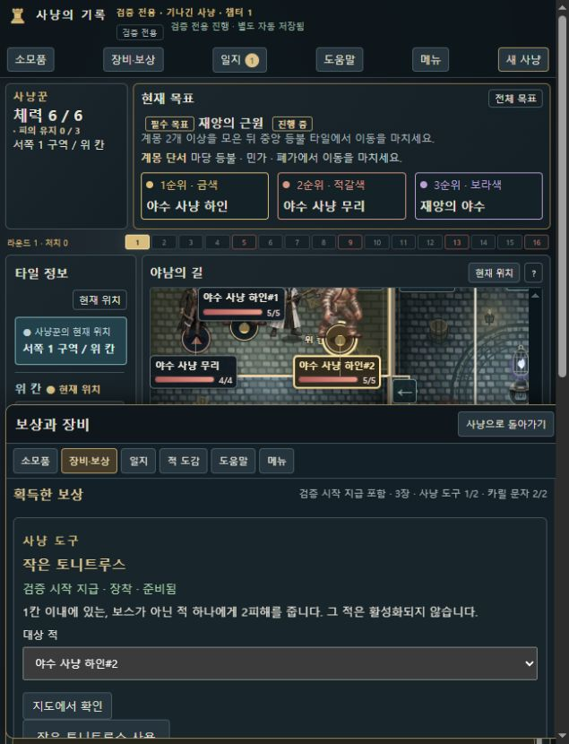

# 화면별 정보 밀도·조작 검토 · 0.8.13-dev.18

긴 대상 라벨을 늘리는 대신, **짧게 선택하고 지도에서 대상·체력·계몽을 확인하는 방식**으로 정리했습니다. 소스·DOM 검사, 실제 화면 표본, 실제 효과 실행을 구분합니다. 전체 결과와 재현 입력은 [점검 본문](README.md)에 있습니다.

## 실제 화면 표본

아래6개만 현재 화면 근거로 사용합니다. 긴 라벨을 사용하던 이전 캡처는 최종 UI의 근거가 아닙니다. 정지 화면은 배치를 보여 주며 애니메이션·모든 후속 행동의 통과 증거를 대신하지 않습니다.

| 화면 | 확인한 표시 | 이 캡처만으로 주장하지 않는 내용 |
| --- | --- | --- |
| [보상 드로어](evidence/compact-target-drawer.jpg) | 짧은 #번호·창을 연 채 보이는 지도·선택 강조·HP 카드·압축 목록 | 모든 보상 분기의 실제 결과·전체 키보드 사용성 |
| [소모품 대상](evidence/compact-inventory-target.jpg) | 돌멩이 #2·목적지·같은 적의 지도 강조·사용 버튼과 비용 | 선택만으로 소모품이 사용된다는 주장 |
| [도끼 추가 피해](evidence/compact-axe-targets.jpg) | 짧은 이름과 피해2·고정 영역의 선택/지도 확인 쌍·각 HP | 모든 무기의 처치 후 선택 네이티브 실행 |
| [보스 상태](evidence/compact-boss-status.jpg) | 성직자 야수 HP·공개된 계몽0·대응 조건·확정 버튼 | 챕터3 표기를 새 캠페인 완수로 집계 |
| [650×850 하단 시트](evidence/compact-target-bottom-sheet.jpg) | 지도를 남긴 하단 선택창·대상2 상태 | 모든 휴대기기·가상 키보드 크기의 동작 |
| [타이틀 도움말](evidence/compact-title-help.jpg) | 일반 이동·탐험·전투3단계 우선·닫힌 상세 항목 | 초보 사용자의 전체 캠페인 완주 |

[실제 배치 관찰](native-layout-observations.json)은 최종 스크립트 해시와 화면 크기·경계를 기록합니다. 1280×720의 상태 카드3개 경계가 겹치지 않았고, 650×850에서는 하단 배치와 선택 대상 카드가 시트 위에 보이는 것을 측정했습니다. 이 한 화면의 결과를 모든 적 배치에 일반화하지 않습니다.

## 타이틀·도움말·새 사냥·메뉴

- 도움말은 일반 플레이 이동·탐험·전투3단계를 먼저 보여 주고 검증 모드·세부 규칙은 펼쳐 읽습니다. 실제 버튼 이름과 카드·빈 슬롯·회피 확정·전투 처리 순서를 남겼습니다.
- 새 사냥의 무기·형태·시작 칸 선택은 유지하며 준비 시드는 고급 설정으로 접었습니다. 자동 시드와 직접 입력한 시드로 정상 시작하는 두 경로를 검사했습니다.
- 지도 기호·시작 위치 규칙 등 참고 정보는 접었습니다. 저장·불러오기·기존 진행 복원 버튼은 유지합니다.

근거: [기본 도움말·시작3검사](../../../tests/ui-information-density-v0818.test.cjs), [공유 도움말](../../../game-help.js), [화면 구조](../../../hunt.html).

## 사냥꾼·지도·장비

- 체력·피의 유지·현재 위치를 남기고 독·발광은 실제 있을 때만 상태 칩을 표시합니다.
- 같은 현재·열람 위치 설명은 반복하지 않습니다. 다른 타일을 보는 경우는 별도로 표시합니다.
- 강화 없는 슬롯은 속도·피해만, 실제 강화는 기본+강화 계산을 표시합니다. 각 슬롯의 ‘선택하여 공격/회피’ 반복 문구를 줄이고 **빈 슬롯 필수 안내는 패널 한 줄로 유지**합니다.
- 시각적인 중복 선택 요약은 숨기되 접근성용 상태 알림을 남깁니다. 카드·슬롯·준비/소진·확정·적용 효과·실제 비용은 유지합니다.
- 지도 HP 막대는 실제 현재/최대 HP 비율이며 공개된 계몽0도 표시합니다. 상위 레이어 카드·연결선·후보 배치로 겹침을 줄입니다. 이동 중에는 실제 보간 좌표를 따라가며 모든 겹침 구성을 해결했다고 주장하지 않습니다.

근거: [대상22검사](../../../tests/playtest-target-selection-ui-v0818.test.cjs), [위치4검사](../../../tests/playtest-location-target-ui-v0815.test.cjs), [표현8검사](../../../tests/target-selection-presentation-v0818.test.cjs).

## 대상 선택과 접근성 경계

- 단독 적은 이름만, 동명 적은 현재 배열 등장 순서 #번호입니다. 물리 피규어 재사용 번호·실제 명령 ID는 바꾸지 않습니다.
- 선택 즉시 지도를 맞추며 창을 닫거나 컨트롤 초점을 빼앗지 않습니다. 최근 유효 선택은 재렌더·창 재개에 보존하고, 소모품의 유효하지 않은 대상·목적지는 변경 사실을 알립니다.
- 실제 적 선택지가 있는 소모품·보상만 투명 우측 드로어를 사용합니다. 700px 이하는 최대45dvh 하단 시트입니다. 다른 정보창은 기존 모달을 유지합니다.
- native `showModal()`의 초점·배경 inert 동작을 유지합니다. 지도가 보인다고 뒤의 게임 버튼도 조작할 수 있다고 안내하지 않습니다. 명시적인 지도 확인은 창을 닫고 마커에 초점을 보냅니다.
- HP는 `progressbar` 현재/최대값, 계몽은 개수, 선택은 `aria-pressed`로 전달합니다. 선택 스프라이트는 불투명도72–100%로 강조하며 모션 감소 설정은 정적입니다. 화면 읽기 도구로 전체 흐름을 직접 검증한 결과는 아닙니다.

[실제 내보내기4건](native-verification.json)에서 작은 토니트루스 #2만5→3, 돌멩이 #2만 아래 칸 이동, 도끼 #2만5→3을 확인했습니다. 다른 한 건은 지도 미리보기만으로 저장 바이트가 바뀌지 않은 확인입니다. [대조 스크립트](verify-native-exports.cjs)는 효과3건의 전체 상태와 미리보기1건의 바이트 동일성을 구분합니다.

## 공개 목표·구원·챕터

- 필수/계몽 목표·공개 조건·실행 행동은 유지하고 일지의 중복 제목을 정리했습니다.
- 구원은 남은 토큰과 완료 처치를 구분해0/2·1/2·2/2로 표시합니다. 진행 중에는 NPC 칸에서 도보 동행을 선택할 수 있다는 힌트를 붙입니다. 동행을 자동 선택하거나 미공개 보상을 읽지 않습니다.
- 보상→마지막 꿈 성장→다음 챕터 준비를 유지하되 현재 단계의 자세한 설명만 표시합니다.
- 화기 획득·부착 안내는 줄이고 장착/보관·실제 슬롯 공격·속도·재배치 조건·손실 경고는 유지합니다.

[구원8검사](../../../tests/salvation-progress-ui-v0818.test.cjs)는 규칙13의 기존 공개 명령 이력입니다. 부모 dev.17 일반 플레이 관찰 파일을 로컬에서 열거나 그 진행을 새로 플레이한 결과가 아닙니다.

## 단계 전반을 확인한 방법

[단계 범위 JSON](phase-coverage.json)의 규칙11 이력2개·683명령에서 대표 DOM43표본이 모두 통과했고22/33단계에 도달했습니다. 정책 채택 네 함수를 항등 함수로 격리하고 버튼을 누르지 않은 표본입니다. 현재 정책의 전체 플레이나 네이티브33단계 조작으로 소개하지 않습니다.

나머지11종은 기존 UI 근거7종과 새 핸들러4종을 연결했습니다. [추가 핸들러 실행](phase-handler-verification.json)의7검사는 다음을 확인합니다.

- `spawn_choice`: 고른 피규어 재사용·다른 후보 보존·추가 카드 비용 없음.
- `ability_choice`: 고른 카드만1장 지불하거나 생략 후 속도/회피 불가 처리.
- `cheap_shot`: 다른 적 열람에도 고정 조우 대상 유지·사용/생략 비용과 후속 처리.
- `exchange_choice`: 실제 수집 소모품 교환/생략·피의 유지·추가 손패 비용 대조.

앞의 세 종류는 구성 단위 입력이고 교환은 규칙14 공개 명령·엄격한 불러오기입니다. 기존7종의 파일은 별도 조사에서 읽어 연결했고, 해당 테스트 파일도 최종 전체 CI에 포함되어 통과했습니다. **단계마다 UI 근거를 연결한 것과 모든 분기를 네이티브로 완주한 것은 다릅니다.**

최종 로컬 CI는 **3,028/3,028 통과**했고 실행 전후 보호 대상605개 파일의 해시가 동일했습니다. [최종 결과](full-ci-verification.json)와 [점검 본문](README.md)에 범위를 기록했습니다. 원본 사진 의존4검사는 기존 정책대로 제외했으며 원격 CI·추가 캠페인 완수를 주장하지 않습니다.
