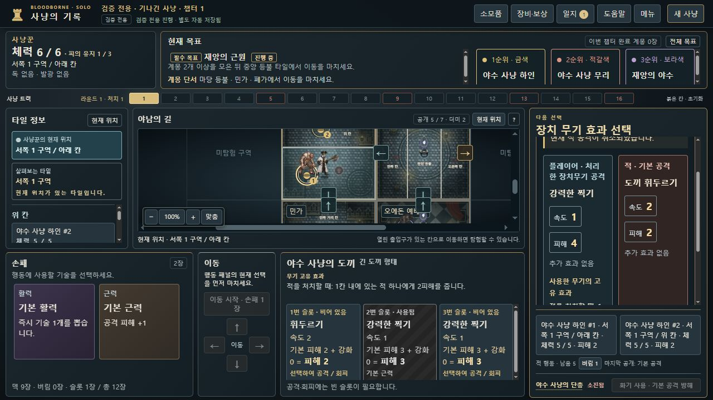
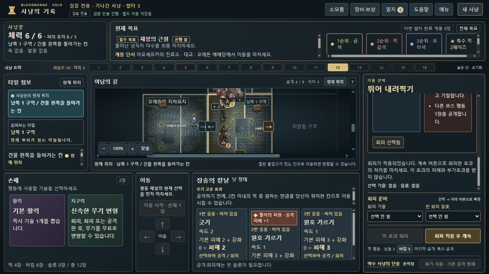

# dev.15 합성 QA 저장 2개 · 직접 불러오기용

**실제 플레이로 얻은 캠페인 진행·완주 성과가 아닙니다.** 정해진 조건을 재현하기 위해 QA 시작 지급과 정상 명령을 사용해 만든 합성 자료입니다. 두 파일 모두 화면에 ‘검증 전용’으로 표시됩니다. 사용 후에는 원래 플레이 저장을 정상 불러와 복원하세요.

이 폴더의 `SYNTHETIC-QA-*.json` 두 파일은 게임의 `bloodborne-hunt-save`, version 1 저장 형식입니다. 메뉴의 **불러오기**에서 파일을 바로 선택합니다. 이전 `reproduction-inputs.json`처럼 `createArgs`를 실행하거나 변환할 필요가 없습니다. `manifest.json`은 파일 설명이며 게임에서 불러올 대상이 아닙니다.

제품 기준: **0.8.13-dev.15**, 커밋 `179afaefd273e2e386714ed7ec80d217ef1e676e`. 이번 추가 작업은 QA 자료만 제공합니다. 제품·판정·불러오기 검증 로직을 변경하거나 머지·배포하지 않았습니다.

| 불러올 파일 | 재현 시작 상태 |
|---|---|
| [SYNTHETIC-QA-axe-target-choice.json](SYNTHETIC-QA-axe-target-choice.json) | 도끼 긴 형태, 추가 2피해 대상 선택 직전. 체력 5인 하인 #1·#2가 1칸 이내에 있습니다. |
| [SYNTHETIC-QA-bone-leap-slam.json](SYNTHETIC-QA-bone-leap-slam.json) | 성직자 야수 2페이즈 ‘뛰어 내려찍기’ 대응 직전. 사냥꾼 HP 6, 유골 장착·준비됨, 아직 회피하지 않은 상태입니다. |

## 도끼 재현

1. 메뉴 → 불러오기 → `SYNTHETIC-QA-axe-target-choice.json`을 선택합니다.
2. ‘장치 무기 효과 선택’의 고정 버튼 두 개를 확인합니다.
   - 하인 #1 · 서쪽 1 구역 / 아래 칸 · 체력 5/5 · 피해 2
   - 하인 #2 · 서쪽 1 구역 / 위 칸 · 체력 5/5 · 피해 2
3. 하나를 선택하면 **선택한 하인만 5→3**, 다른 하인은 5를 유지하고 사냥꾼 차례가 됩니다. 사냥꾼 HP는 6입니다.
4. 다른 선택지는 원본 파일을 다시 불러온 뒤 독립적으로 확인합니다.

시드 3, 합성 QA 지급은 검증용 이동 소모품 1개뿐입니다. 명령 15개에는 현재 UI가 사용하는 타일 속도 해석의 명시적 채택 1회가 포함됩니다.



## 유골 자동 회피 재현

1. 메뉴 → 불러오기 → `SYNTHETIC-QA-bone-leap-slam.json`을 선택합니다.
2. ‘뛰어 내려찍기’의 피해 2·기절, HP 6을 확인합니다. 아직 회피하지 않았으므로 계속 버튼은 ‘피해 2와 효과를 받고 계속’입니다.
3. **고대 사냥꾼의 유골 · 자동 회피**를 누릅니다. 손패·슬롯을 고를 필요가 없습니다.
4. 회피 적용 안내와 **회피 적용 후 계속** 버튼을 확인합니다. 유골은 소진되고 HP 6, 손패 2장과 빈 슬롯은 유지됩니다.
5. 계속하면 이 효과의 피해·기절을 받지 않습니다. 이 합성 입력에서는 보스의 다음 ‘회복’ 카드가 처리되고, 남은 적의 ‘적과 조우’ 단계로 이어집니다. HP는 6, 손패는 2장입니다.

시드 90, 유골을 QA 시작 지급으로 보유시킨 뒤 기존 명령 경로에 합법적인 보상 교체·전투 선택을 더한 합성 입력입니다. 명령 350개에 현재 타일 속도 해석 채택 1회가 포함됩니다. 파일 안에 챕터 3 상태가 있어도 일반 플레이의 1~3장 완수로 집계하지 않습니다.



## 확인한 범위와 재검사

- 원래 상태를 수동 편집해 넣거나 불러오기 검증을 우회하지 않았습니다. 시작 설정과 모든 정상 명령을 재생하여 생성했고, 현재 UI의 호환 해석 채택도 정상 명령으로 기록했습니다.
- 두 최종 파일의 엄격한 `E.importSave` 검사와 재내보내기 바이트 일치를 확인했습니다. 도끼 양쪽 대상과 유골 사용→계속의 결과 저장도 재생 검사를 통과합니다.
- 별도 8815 주소의 실제 브라우저에서 **이 폴더의 최종 두 파일**을 정상 불러왔습니다. 도끼 양쪽 선택의 피해, 유골 후 문구·HP·손패·후속 단계를 확인했습니다. 실제 UI로 내보낸 도끼/유골 결과가 실제 reducer 결과 전체와 일치합니다.
- 제품·자산·기존 테스트 595파일의 해시가 dev.15 검사본과 같습니다. 기존 2928개 전체 검사를 이번 자료 추가 때문에 다시 실행한 것으로 주장하지 않습니다. 추가 검증은 아래 QA 자료 검사와 실제 UI 확인입니다.
- 파일 크기·SHA-256은 [manifest.json](manifest.json), 실제 화면·증거 해시는 [native-ui-verification.json](native-ui-verification.json)에 있습니다. 개인 플레이 저장은 포함하지 않습니다.

저장소 루트에서 추가 자료만 재검사할 수 있습니다.

```powershell
node docs/qa/dev15-synthetic-ui/verify.cjs
```
